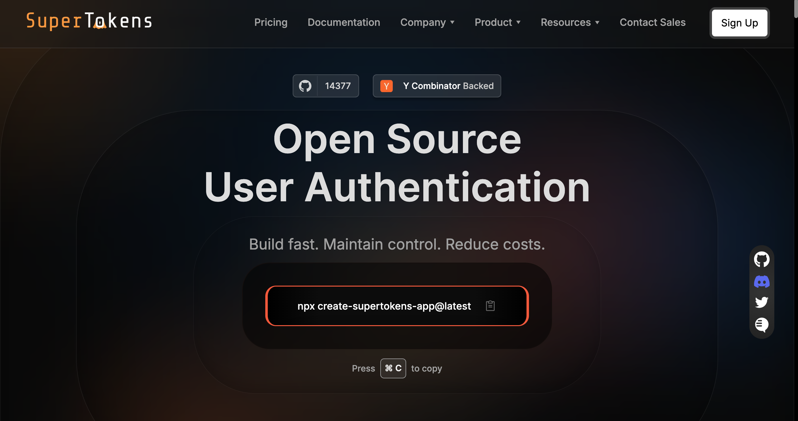

**Firebase Authentication is free for email, social and anonymous sign-in up to 50,000 monthly active users (MAUs). Above that, projects upgraded to Firebase Authentication with Identity Platform pay $0.0055 per MAU from 50,000 to 100,000 users, falling in steps to $0.0025 at 10 million and above. SAML and OIDC users cost $0.015 per MAU after the first 50. Phone sign-in and SMS multi-factor codes are billed per SMS sent, from $0.01 in the US to $0.46 in some regions, and need the pay-as-you-go Blaze plan.**

*Prices checked: 2 November 2026, against the [Firebase pricing page](https://firebase.google.com/pricing), [Identity Platform pricing](https://cloud.google.com/identity-platform/pricing), [Firebase Authentication docs](https://firebase.google.com/docs/auth#identity-platform) and [Firebase Authentication limits](https://firebase.google.com/docs/auth/limits). Google can change these rates, so confirm them before you budget.*

## Table of Contents

- [Firebase Auth pricing at a glance](#firebase-auth-pricing-at-a-glance)
- [Spark vs Blaze: what changes for authentication](#spark-vs-blaze-what-changes-for-authentication)
- [Firebase Auth vs Firebase Auth with Identity Platform](#firebase-auth-vs-firebase-auth-with-identity-platform)
- [Per-MAU pricing tiers](#per-mau-pricing-tiers)
- [Phone and SMS authentication pricing](#phone-and-sms-authentication-pricing)
- [Worked monthly cost examples](#worked-monthly-cost-examples)
- [Costs that surprise people on the bill](#costs-that-surprise-people-on-the-bill)
- [Recent Firebase pricing changes](#recent-firebase-pricing-changes)
- [When Firebase Auth gets expensive, and what alternatives cost](#when-firebase-auth-gets-expensive-and-what-alternatives-cost)
- [How to keep your Firebase Auth bill down](#how-to-keep-your-firebase-auth-bill-down)
- [Frequently Asked Questions](#frequently-asked-questions)

## Firebase Auth Pricing at a Glance

| Item | Spark (no-cost) plan | Blaze (pay-as-you-go) plan |
|---|---|---|
| Email, social, anonymous and custom sign-in | Free. With the Identity Platform upgrade, capped at 3,000 daily active users | First 50,000 MAUs free, then $0.0055 → $0.0025 per MAU (with the Identity Platform upgrade) |
| SAML and OIDC sign-in (Identity Platform only) | Capped at 2 daily active users | First 50 MAUs free, then $0.015 per MAU |
| Phone sign-in (SMS) | Not available | Billed per SMS sent, by destination country. First 10 SMS per day are not billed |
| SMS multi-factor authentication (Identity Platform only) | Not available | Same per-SMS rates as phone sign-in |
| SMS sending limit | — | 3,000 SMS/day without the upgrade; no daily cap with Identity Platform |
| Password reset emails | 150/day | 10,000/day |
| Email link (passwordless) sign-in emails | 5/day | 25,000/day |
| Blocking functions | Not available | Billed at Cloud Run functions rates |

A note on the 50,000 figure: the Firebase pricing page lists 50,000 MAUs as the no-cost limit on both plans. The Firebase Authentication docs add that once you upgrade to Identity Platform, Spark projects are limited to 3,000 daily active users instead. Without the upgrade, the docs list no user limit for email, social, anonymous and custom sign-in.

## Spark vs Blaze: What Changes for Authentication

Firebase has two [pricing plans](https://firebase.google.com/docs/projects/billing/firebase-pricing-plans):

- **Spark** is the no-cost plan. You don't add a payment method, usage is limited to the no-cost quotas, and you can't be billed.
- **Blaze** is pay-as-you-go. You link a Cloud Billing account, keep the same no-cost quotas, and pay only for usage above them. New Google Cloud customers may be eligible for $300 in free credit.

For authentication, Blaze matters because:

1. **Phone sign-in needs Blaze.** Since September 2024, a project must be linked to a Cloud Billing account to send SMS for phone authentication. The free SMS that Spark projects used to get were removed.
2. **Usage above the free tier needs Blaze.** On Spark an upgraded project stops at 3,000 daily active users. On Blaze it keeps working and you pay per MAU above 50,000.
3. **Higher email limits.** Spark allows 150 password reset emails and 5 email-link sign-in emails per day. Blaze raises these to 10,000 and 25,000.
4. **Blocking functions and other Cloud Functions need Blaze.** The Firebase pricing page lists Cloud Functions as not available on Spark.

Budget alerts on Blaze notify you when spending crosses a threshold, but they **do not cap your usage or charges**.

## Firebase Auth vs Firebase Auth with Identity Platform

Firebase Authentication comes in two versions, and they're priced differently.

**Firebase Authentication** (the base product) supports email and password, social providers, anonymous sign-in, custom tokens and phone sign-in. Firebase's docs list no user limit for non-phone sign-in on this version. Phone sign-in is billed per SMS and capped at 3,000 SMS per day.

**Firebase Authentication with Identity Platform** is an optional upgrade you turn on in the Firebase console's Authentication settings. Your existing SDK code keeps working, and you get:

- Multi-factor authentication (MFA) with SMS
- Blocking functions that run custom code during sign-up and sign-in
- SAML (web only) and generic OpenID Connect providers
- User activity and audit logging
- Multi-tenancy
- A 99.95% uptime SLA, enterprise support, and BAA coverage
- Optional automatic clean-up of anonymous accounts older than 30 days, which then don't count towards billing

The trade-off is that the upgrade introduces **per-MAU billing** above 50,000 MAUs on Blaze, and a **3,000 daily active user cap** on Spark. It also removes the 3,000 SMS per day limit. If you need MFA, SAML, OIDC or multi-tenancy, you need the upgrade.

## Per-MAU Pricing Tiers

An MAU is any account that signed in during the month. Users who don't sign in that month are stored at no cost. Pricing is graduated: each band's rate applies only to the users within that band.

**Tier 1 providers: email, phone, anonymous and social**

| Monthly active users | Price per MAU |
|---|---|
| 0–50,000 | Free |
| 50,000–100,000 | $0.0055 |
| 100,000–1,000,000 | $0.0046 |
| 1,000,000–10,000,000 | $0.0032 |
| 10,000,000+ | $0.0025 |

**Tier 2 providers: SAML and OpenID Connect**

| Monthly active users | Price per MAU |
|---|---|
| 0–50 | Free |
| 50+ | $0.015 |

Tier 1 and Tier 2 are billed separately, so 50 SAML users don't use up any of your 50,000 free Tier 1 users. Phone users count towards Tier 1 MAUs **and** pay for the SMS they receive.

Source: [Identity Platform pricing](https://cloud.google.com/identity-platform/pricing).

## Phone and SMS Authentication Pricing

Every SMS sent for phone sign-in or SMS MFA is billed by destination country. The first 10 SMS you send each day aren't billed. Google's own pricing examples count this as 300 free SMS per month.

| Destination | Price per SMS |
|---|---|
| United States | $0.01 |
| Canada | $0.01 |
| Brazil | $0.02 |
| Australia | $0.02 |
| United Kingdom | $0.04 |
| India | $0.07 |
| France | $0.07 |
| Germany | $0.10 |
| Nigeria | $0.21 |
| Indonesia | $0.35 |
| All other regions not listed | $0.46 |

A selection from Google's full table. See [Identity Platform pricing](https://cloud.google.com/identity-platform/pricing) for every country.

You pay for every SMS **sent**, not every successful sign-in. Retries, abandoned logins and fraudulent traffic all count. Firebase's [troubleshooting guide](https://firebase.google.com/docs/auth/faq-and-troubleshooting) warns that a verification success rate below 50% is a common sign of SMS traffic pumping. New projects have an SMS region policy that allows no regions by default, so you choose which countries can receive codes.

Limits:

- Base Firebase Authentication: 3,000 SMS per day per project
- With Identity Platform: no daily cap
- 900 SMS per minute per project, plus 50 per minute and 500 per hour per IP address

## Worked Monthly Cost Examples

These examples assume a Blaze project upgraded to Firebase Authentication with Identity Platform, so per-MAU billing applies. They include authentication charges only. Firestore, Cloud Functions, Hosting and other Firebase services are extra.

### Email and social sign-in only

Assumptions: every user signs in with email/password, Google or Apple. No SMS, no SAML.

| MAUs | Calculation | Monthly cost |
|---|---|---|
| 1,000 | Within the 50,000 free tier | **$0** |
| 10,000 | Within the 50,000 free tier | **$0** |
| 50,000 | Within the 50,000 free tier | **$0** |
| 100,000 | 50,000 free + 50,000 × $0.0055 = $275 | **$275** |
| 500,000 | 50,000 free + 50,000 × $0.0055 ($275) + 400,000 × $0.0046 ($1,840) | **$2,115** |

If you don't need MFA, SAML, OIDC or multi-tenancy, you can stay on base Firebase Authentication. In that case these sign-in methods have no per-MAU charge at any scale.

### Phone (SMS) sign-in

Assumptions: phone number is the main sign-in method, every MAU receives one verification SMS per month, and 300 SMS per month are free (10 per day). Real apps usually send more than one SMS per user because of retries and new devices, so treat these as lower bounds.

Two region mixes:

- **US-only:** every SMS costs $0.01
- **Global:** 40% US ($0.01), 20% India ($0.07), 15% UK ($0.04), 15% Germany ($0.10), 10% Brazil ($0.02). Weighted average: (0.4 × 0.01) + (0.2 × 0.07) + (0.15 × 0.04) + (0.15 × 0.10) + (0.1 × 0.02) = **$0.041 per SMS**

| MAUs | SMS billed | MAU charge | US-only total | Global total |
|---|---|---|---|---|
| 10,000 | 10,000 − 300 = 9,700 | $0 | 9,700 × $0.01 = **$97** | 9,700 × $0.041 = **$397.70** |
| 50,000 | 49,700 | $0 | **$497** | **$2,037.70** |
| 100,000 | 99,700 | $275 | $997 + $275 = **$1,272** | $4,087.70 + $275 = **$4,362.70** |

At 100,000 users, a phone-first app costs between 4.6 and 16 times as much as the same app with email and social login ($275). At this volume you would also pass the 3,000 SMS per day limit of base Firebase Authentication, so the Identity Platform upgrade is effectively required.

### Email sign-in with SMS multi-factor authentication

Assumptions: 100,000 MAUs sign in with email or social login; 20% of them receive one SMS MFA code per month (20,000 SMS); all SMS go to the US.

- MAUs: 50,000 × $0.0055 = $275
- SMS: (20,000 − 300) × $0.01 = $197
- **Total: $472/month**

### B2B app with SAML SSO

Assumptions: 20,000 email MAUs, plus 2,000 employees of enterprise customers signing in with SAML.

- Tier 1: 20,000 MAUs, within the free tier = $0
- Tier 2: (2,000 − 50) × $0.015 = $29.25
- **Total: $29.25/month**

SAML gets expensive only at volume. Google's own example, with 77,000 SAML and OIDC users, comes to about $1,154/month.

## Costs That Surprise People on the Bill

1. **SMS, by a wide margin.** Phone sign-in is the cost most likely to dominate an auth bill, especially with users outside North America. A single SMS to an unlisted region costs $0.46, which is the same as about 84 MAUs at $0.0055.
2. **SMS pumping.** Bots that trigger codes to premium-rate numbers inflate your bill without creating real users. Use SMS region policy, keep reCAPTCHA verification on, and watch your sent-to-verified ratio.
3. **The Identity Platform upgrade itself.** It turns on MFA and SAML, but it also introduces per-MAU billing above 50,000 users and the 3,000 daily active user cap on Spark.
4. **Anonymous users.** They count as Tier 1 MAUs unless you enable automatic clean-up, which needs the upgrade.
5. **Blocking functions and auth triggers.** These run on Cloud Run functions and are billed separately. Cloud Functions on Blaze includes 2 million free invocations per month, then $0.40 per million, plus compute and outbound networking ($0.12/GB above 5 GB).
6. **Email limits on Spark.** Spark allows only 5 email-link sign-in emails and 150 password reset emails per day. Passwordless email login effectively needs Blaze.
7. **Everything else on Blaze.** Moving to Blaze for phone auth puts the whole project on pay-as-you-go. Firestore (beyond 50,000 reads and 20,000 writes per day), Hosting (beyond 360 MB/day transfer, then $0.15/GB), and Cloud Storage all start billing beyond their free quotas, and budget alerts don't stop charges.

## Recent Firebase Pricing Changes

- **No Authentication rate changes found in the last 12 months.** The per-MAU rates above are the same as in the previous version of this guide (September 2025), and we found no Google announcement of an Auth price change since then.
- **September 2024: SMS requires billing.** Projects must be linked to a Cloud Billing account to use phone authentication. The no-cost SMS on Spark were removed.
- **Email link sign-in limit on Spark.** Firebase's limits page says this limit was "recently changed" to 5 emails per day without a billing account. It doesn't give a date.
- **Non-auth changes:** From 1 September 2026, Remote Config fetches on Blaze above 100,000 per day cost $0.06 per 10,000 requests. Since September 2024, new Cloud Storage buckets (`*.firebasestorage.app`) need the Blaze plan.

## When Firebase Auth Gets Expensive, and What Alternatives Cost

Per MAU, Firebase Authentication is one of the cheapest hosted auth services. For an email and social app, it's hard to beat: $0 up to 50,000 users and $2,115 at 500,000. Costs climb mainly in four situations:

- Phone-first sign-in, or SMS MFA, for users in high-cost countries
- Large numbers of SAML or OIDC enterprise users at $0.015 each
- Needing features (MFA, multi-tenancy, audit logs) that require the upgrade
- Wanting to run auth outside Google Cloud for data residency or to avoid lock-in, which Firebase doesn't offer

*Authentication cost only, for email and social sign-in. Prices checked 2 November 2026 from each vendor's public pricing page.*

| MAUs | Firebase Auth (Identity Platform) | SuperTokens self-hosted | SuperTokens managed | Clerk (Pro, monthly) |
|---|---|---|---|---|
| 10,000 | $0 | $0 + your hosting | $100 | $25 |
| 50,000 | $0 | $0 + your hosting | $900 | $25 |
| 100,000 | $275 | $0 + your hosting | $1,900 | $1,025 |
| 500,000 | $2,115 | $0 + your hosting | $9,900 | $8,225 |

How these are calculated:

- **SuperTokens managed:** $0.02 per MAU above the free 5,000. For example, at 100,000 MAUs: 95,000 × $0.02 = $1,900. MFA is an add-on at $0.01 per MAU (minimum $100/month). See [SuperTokens pricing](https://supertokens.com/pricing).
- **SuperTokens self-hosted:** The open source core is free with no MAU limit. You pay for the servers and database you run it on. Paid add-ons such as MFA and multi-tenancy are priced separately.
- **Clerk:** Pro is $25/month including 50,000 monthly retained users, then $0.02 per user to 100,000 and $0.018 from 100,000 to 1 million. At 500,000: $25 + (50,000 × $0.02) + (400,000 × $0.018) = $8,225. See our [Clerk pricing guide](/blog/clerk-pricing-the-complete-guide).
- **Auth0:** The Free plan covers up to 25,000 MAUs, and paid B2C plans start at $35/month for 500 MAUs. See [Auth0 pricing](https://auth0.com/pricing) and our [Auth0 pricing guide](/blog/auth0-pricing-the-complete-guide).

On per-MAU price alone, Firebase is cheaper than SuperTokens' managed service. The case for [SuperTokens](https://supertokens.com/) is different: you can self-host it for free with no per-user fees, run it on any cloud or on-premises, and keep your user data in your own database. That matters most for apps with very large user counts, strict data-residency requirements, or a backend that isn't on Google Cloud. With any provider, including SuperTokens, you still pay your SMS provider for each SMS.

If you're weighing a move, see [Firebase alternatives](/blog/firebase-alternatives), [cheapest Auth0 alternatives](/blog/cheapest-auth-alternatives), [self-hosted authentication](/blog/self-hosted-authentication), and [how to migrate users without downtime](/blog/migrating-users-without-downtime-in-your-service).

## How to Keep Your Firebase Auth Bill Down

- **Default to email or social sign-in** and offer SMS only where users need it.
- **Restrict SMS regions** to the countries you actually serve, using SMS region policy.
- **Keep reCAPTCHA verification enabled** for phone auth to block automated abuse.
- **Watch sent vs verified SMS** in the Firebase console, or by region in Metrics explorer in the Google Cloud console.
- **Enable automatic clean-up of anonymous users** if you use anonymous sign-in on an upgraded project.
- **Only upgrade to Identity Platform if you need its features.** For email and social sign-in, base Firebase Authentication has no per-MAU charge.
- **Set budget alerts**, and remember they notify you but don't stop charges.

## Frequently Asked Questions

### Is Firebase Authentication free?

Yes, for most apps. Email, social, anonymous and custom sign-in are free up to 50,000 monthly active users, and base Firebase Authentication lists no user limit for these methods. Phone sign-in needs the Blaze plan and is billed per SMS sent, although the first 10 SMS each day aren't billed.

### How much does Firebase Auth cost per MAU?

With the Identity Platform upgrade on the Blaze plan, the first 50,000 MAUs are free. Then it's $0.0055 per MAU from 50,000 to 100,000, $0.0046 to 1 million, $0.0032 to 10 million, and $0.0025 above that. SAML and OIDC users cost $0.015 per MAU after the first 50. For example, 100,000 MAUs costs $275 a month.

### What happens when I exceed the Firebase Auth free tier?

On the Blaze plan, you're billed for each MAU above 50,000 at the tiered rates, and sign-ins keep working. On the no-cost Spark plan, a project upgraded to Identity Platform is limited to 3,000 daily active users, and you need to move to Blaze to go beyond that. Spark never charges you.

### Is SMS authentication extra in Firebase?

Yes. Phone sign-in and SMS multi-factor codes are billed per SMS sent, on top of any MAU charges. Prices depend on the destination country, from $0.01 in the US and Canada to $0.46 in some regions. Phone authentication requires the Blaze plan, and base Firebase Authentication is limited to 3,000 SMS per day.

### What's the difference between Firebase Auth and Identity Platform pricing?

Base Firebase Authentication has no per-MAU charge for email, social and anonymous sign-in, and charges only for SMS. Firebase Authentication with Identity Platform adds MFA, SAML, OIDC, blocking functions, multi-tenancy and an SLA. In return, it bills $0.0025 to $0.0055 per MAU above 50,000 on Blaze, and caps Spark projects at 3,000 daily active users.

### How much does Firebase Auth cost for 100,000 users?

For email and social sign-in on an upgraded Blaze project, 100,000 MAUs costs $275 a month (50,000 free plus 50,000 × $0.0055). If every user also receives one US SMS a month, add about $997, for roughly $1,272. Without the Identity Platform upgrade, email and social sign-in has no per-MAU charge.

### Does Firebase charge for password reset or verification emails?

No. Firebase doesn't charge per email, but it does limit how many it sends. On Spark, you can send 150 password reset emails and 5 email-link sign-in emails per day. On Blaze, the limits rise to 10,000 and 25,000 per day.

### Can I self-host instead of using Firebase Auth?

Firebase Authentication can't be self-hosted; it runs only on Google Cloud. If you want to run auth on your own infrastructure, open source options such as SuperTokens can be self-hosted for free with no MAU limits. You pay only for your servers, plus any paid add-ons and your SMS provider.
