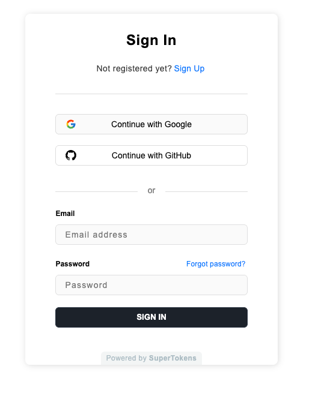
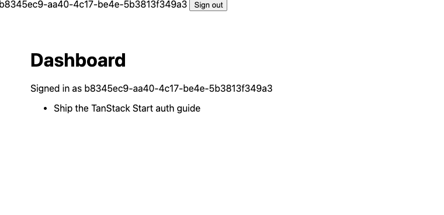

To add authentication to TanStack Start, mount SuperTokens' auth API on a server route, read the session in server functions and `beforeLoad`, and render SuperTokens' prebuilt login UI on an `/auth` route. This guide covers TanStack Start authentication end to end with an open-source, self-hostable provider.

By the end, the app has email/password and Google login, protected routes, protected server functions, and SSR-safe sessions with automatic token refresh. The TanStack Start auth setup uses current APIs only, and the post flags the older ones you will still meet in 2025 tutorials.

## How Authentication Works in TanStack Start

TanStack Start authentication with SuperTokens runs across three layers. A server route serves the auth API. Server functions act as the security boundary. `beforeLoad` on layout routes handles navigation.

|Layer|TanStack Start primitive|Job|
|---|---|---|
|Auth API|Server route at `/api/auth/*`|Sign-in, sign-up, sign-out, token refresh|
|Security boundary|`createServerFn` + `createMiddleware`|Verify the session before reading or writing private data|
|User experience|`beforeLoad` on a layout route|Redirect signed-out users before a page renders|

One line matters more than the rest. **In TanStack Start, `beforeLoad` controls navigation, but every `createServerFn` is a public HTTP endpoint, so each one must verify the session itself.** Route guards are UX. The server function is the boundary. You can see why in the browser's Network tab: each server function is a request to a URL under `/_serverFn/`. TanStack's own [authentication overview](https://tanstack.com/start/latest/docs/framework/react/guide/authentication-overview) says the same thing: enforce auth in every server function that reads or writes private data.

## Why Use SuperTokens for TanStack Start Auth

SuperTokens gives TanStack Start auth an open-source backend that you can run yourself, plus a prebuilt React login UI. It fits teams that want to own their user data and avoid per-user pricing.

- **Open source** under Apache 2.0, for both `supertokens-node` and `supertokens-auth-react`.
- **Self-host or managed.** Run the core with Docker, or use the managed service.
- [No per-user pricing when self-hosted](https://supertokens.com/pricing) for core auth. Add-ons such as MFA are billed per user either way.
- **Prebuilt React UI** for sign-in, sign-up and password reset.
- **Rotating refresh tokens** with theft detection, plus recipes for MFA, multi-tenancy and roles.

## Prerequisites

TanStack Start and SuperTokens need three things before you start: a recent Node version, a TanStack Start app, and a SuperTokens core to talk to.

|Requirement|Detail|
|---|---|
|Node|22 or later (tested on `22.22.0`)|
|TanStack Start app|`npx @tanstack/cli create my-app --framework React`|
|SuperTokens core|`https://try.supertokens.com` for local testing; the managed service or Docker for real use|

## Step 1: Install SuperTokens Packages

TanStack Start needs two SuperTokens packages: `supertokens-node` for the server and `supertokens-auth-react` for the login UI. The React SDK pulls in `supertokens-web-js` on its own, so you do not install it separately.

```bash
npm install supertokens-node@24.0.3 supertokens-auth-react@0.51.3
```

## Step 2: Configure the SuperTokens Backend

With your app info and recipes. Start with the shared app info, which both server and browser read.

```ts
// src/config/appInfo.ts
export const appInfo = {
 appName: 'TanStack Start + SuperTokens',
 apiDomain: 'http://localhost:3000',
 websiteDomain: 'http://localhost:3000',
 apiBasePath: '/api/auth',
 websiteBasePath: '/auth',
}
```

`apiBasePath: "/api/auth"` tells SuperTokens where its API lives, so sign-in becomes `POST /api/auth/signin`. `websiteBasePath: "/auth"` tells it where the login UI lives. Both must match the routes you create in Steps 3 and 5.

Now the backend config. It enables email/password, Google and GitHub, and sessions.

```ts
// src/server/supertokens.ts
import SuperTokens from 'supertokens-node'
import EmailPassword from 'supertokens-node/recipe/emailpassword'
import ThirdParty from 'supertokens-node/recipe/thirdparty'
import Session from 'supertokens-node/recipe/session'
import { appInfo } from '#/config/appInfo'

const provider = (thirdPartyId: string, prefix: string) => ({
 config: {
   thirdPartyId,
   clients: [{
     clientId: process.env[`${prefix}_CLIENT_ID`] ?? '',
     clientSecret: process.env[`${prefix}_CLIENT_SECRET`] ?? '',
   }],
 },
})

let initialized = false

export function ensureSuperTokensInit() {
 if (initialized) return
 SuperTokens.init({
   framework: 'custom',
   supertokens: {
     connectionURI: process.env.SUPERTOKENS_CONNECTION_URI ?? 'https://try.supertokens.com',
     apiKey: process.env.SUPERTOKENS_API_KEY,
   },
   appInfo,
   recipeList: [
     EmailPassword.init(),
     ThirdParty.init({
       signInAndUpFeature: { providers: [provider('google', 'GOOGLE'), provider('github', 'GITHUB')] },
     }),
     Session.init(),
   ],
 })
 initialized = true
}
```

Two details matter here. `framework: 'custom'` tells SuperTokens it will receive standard Web `Request` objects, which is what TanStack Start hands you. `ensureSuperTokensInit()` is idempotent, so every server route and server function can call it safely without initialising twice.

## Step 3: Mount the Auth API on a TanStack Start Server Route

SuperTokens' auth API mounts on a single TanStack Start server route that forwards every HTTP method to `handleAuthAPIRequest()`. A splat route, `$.ts`, catches every path under `/api/auth`.

```ts
// src/routes/api/auth/$.ts
import { createFileRoute } from '@tanstack/react-router'
import { handleAuthAPIRequest } from 'supertokens-node/custom'
import { ensureSuperTokensInit } from '#/server/supertokens'

async function handler({ request }: { request: Request }) {
 ensureSuperTokensInit()
 return handleAuthAPIRequest()(request)
}

export const Route = createFileRoute('/api/auth/$')({
 server: {
   handlers: {
     GET: handler,
     POST: handler,
     PUT: handler,
     DELETE: handler,
     PATCH: handler,
     OPTIONS: handler,
   },
 },
})
```

This is the TanStack Start equivalent of the Next.js App Router catch-all. The route has no component, so it only ever answers HTTP requests.

The splat route forwards whatever path arrives, and SuperTokens decides what it means. Email/password sign-in lands on `/api/auth/signin`, sign-up on `/api/auth/signup`, and sign-out on `/api/auth/signout`. The frontend SDK calls `/api/auth/session/refresh` to rotate tokens. Google and GitHub start their OAuth flow at `/api/auth/authorisationurl` and finish at `/api/auth/signinup`. You never write these handlers yourself. Adding a recipe in Step 2 adds its endpoints.

**Import path:** use `supertokens-node/custom`. Older SuperTokens examples import from `supertokens-node/customFramework`, but that subpath is not in the package's `exports` map in `24.0.3`. Node throws `ERR_PACKAGE_PATH_NOT_EXPORTED` at startup, and TypeScript reports `Cannot find module`. Both paths point at the same helpers.

## Step 4: Initialise SuperTokens on the Frontend

`supertokens-auth-react` reads `window`, so in TanStack Start it must initialise in the browser only. A `typeof window` guard keeps it out of server rendering.

```ts
// src/config/frontend.ts
import SuperTokens from 'supertokens-auth-react'
import EmailPassword from 'supertokens-auth-react/recipe/emailpassword'
import ThirdParty, { Github, Google } from 'supertokens-auth-react/recipe/thirdparty'
import Session from 'supertokens-auth-react/recipe/session'
import { EmailPasswordPreBuiltUI } from 'supertokens-auth-react/recipe/emailpassword/prebuiltui'
import { ThirdPartyPreBuiltUI } from 'supertokens-auth-react/recipe/thirdparty/prebuiltui'
import { appInfo } from '#/config/appInfo'

export const PreBuiltUIList = [EmailPasswordPreBuiltUI, ThirdPartyPreBuiltUI]

let initialized = false

export function ensureFrontendInit() {
 // supertokens-auth-react reads window, so it must never run during SSR.
 if (initialized || typeof window === 'undefined') return
 SuperTokens.init({
   appInfo,
   recipeList: [
     EmailPassword.init(),
     ThirdParty.init({
       signInAndUpFeature: { providers: [Google.init(), Github.init()] },
     }),
     Session.init(),
   ],
 })
 initialized = true
}
```

Next, wrap the app in `SuperTokensWrapper` inside `__root.tsx`. The wrapper sits inside TanStack Router's `ClientOnly`, so the server renders the page content and the browser adds the session context after hydration.

```tsx
// src/routes/__root.tsx
import { ClientOnly, HeadContent, Scripts, createRootRoute } from '@tanstack/react-router'
import { SuperTokensWrapper } from 'supertokens-auth-react'
import { ensureFrontendInit } from '#/config/frontend'
import { SessionStatus } from '#/components/SessionStatus'
import appCss from '../styles.css?url'

ensureFrontendInit()

export const Route = createRootRoute({
 head: () => ({
   meta: [
     { charSet: 'utf-8' },
     { name: 'viewport', content: 'width=device-width, initial-scale=1' },
     { title: 'TanStack Start + SuperTokens' },
   ],
   links: [{ rel: 'stylesheet', href: appCss }],
 }),
 shellComponent: RootDocument,
})

function RootDocument({ children }: { children: React.ReactNode }) {
 return (
   <html lang="en">
     <head>
       <HeadContent />
     </head>
     <body>
       <ClientOnly fallback={children}>
         <SuperTokensWrapper>
           <header><SessionStatus /></header>
           {children}
         </SuperTokensWrapper>
       </ClientOnly>
       <Scripts />
     </body>
   </html>
 )
}
```

The `fallback={children}` prop matters. Without it, the server would render an empty body. With it, the server still renders the full page for SEO and fast first paint.

`SuperTokensWrapper` provides the React context that the prebuilt UI and `useSessionContext()` read. Any component that needs the session in the browser must render inside it.

## Step 5: Add the Login and Sign-Up UI

SuperTokens' prebuilt login UI renders on a TanStack Start splat route at `/auth`, using `canHandleRoute` and `getRoutingComponent`. The splat catches `/auth`, `/auth/reset-password` and every other path the UI needs.

```tsx
// src/routes/auth/$.tsx
import { createFileRoute } from '@tanstack/react-router'
import { canHandleRoute, getRoutingComponent } from 'supertokens-auth-react/ui'
import { PreBuiltUIList } from '#/config/frontend'

export const Route = createFileRoute('/auth/$')({
 // The prebuilt UI reads window.location, so render it in the browser only.
 ssr: false,
 component: AuthPage,
})

function AuthPage() {
 if (canHandleRoute(PreBuiltUIList)) return getRoutingComponent(PreBuiltUIList)
 return <p>Page not found</p>
}
```

`ssr: false` is TanStack Router's selective SSR option. It skips server rendering for this route only, which is exactly what a `window`-dependent login form needs. The rest of the app still renders on the server.

### **Configuring Google and GitHub Login**

TanStack Start social login with Google and GitHub needs OAuth credentials on the server and a provider button on the client. The client side is already done in Step 4 with `Google.init()` and `Github.init()`.

For the server side, create an OAuth app in each provider's console and set the callback URL to `http://localhost:3000/auth/callback/google` or `/auth/callback/github`. Then add the credentials to `.env`:

```bash
# .env
GOOGLE_CLIENT_ID=...
GOOGLE_CLIENT_SECRET=...
GITHUB_CLIENT_ID=...
GITHUB_CLIENT_SECRET=...
```

The `provider()` helper in Step 2 reads these values. The client secrets never reach the browser, because only server code reads them. SuperTokens' [third-party login docs](https://supertokens.com/docs/authentication/social/initial-setup) cover Apple, Facebook and custom OIDC providers the same way.

## Step 6: Read the Session in Server Functions

TanStack Start session management with SuperTokens starts with one helper. It reads the request with `getRequest()`, then verifies it with `getSessionForSSR()`. TanStack Start server functions auth builds on the same helper, through both a public session lookup and the protection middleware.

```ts
// src/server/auth.ts
import { createMiddleware, createServerFn } from '@tanstack/react-start'
import { getRequest, setResponseStatus } from '@tanstack/react-start/server'
import { getSessionForSSR } from 'supertokens-node/custom'
import { ensureSuperTokensInit } from '#/server/supertokens'

export type UserSession =
 | { status: 'authenticated'; userId: string }
 | { status: 'needs-refresh' }
 | { status: 'unauthenticated' }

async function readSession(): Promise<UserSession> {
 ensureSuperTokensInit()
 const { accessTokenPayload, hasToken, error } = await getSessionForSSR(getRequest())
 if (error) throw error
 if (accessTokenPayload?.sub) return { status: 'authenticated', userId: accessTokenPayload.sub }
 // A token exists but did not verify: it has expired, so the client must refresh it.
 if (hasToken) return { status: 'needs-refresh' }
 return { status: 'unauthenticated' }
}

export const getUserSession = createServerFn({ method: 'GET' }).handler(readSession)

export const authMiddleware = createMiddleware({ type: 'function' }).server(async ({ next }) => {
 const session = await readSession()
 if (session.status !== 'authenticated') {
   setResponseStatus(401)
   throw new Error('Unauthorized')
 }
 return next({ context: { userId: session.userId } })
})
```

`getSessionForSSR` returns three fields, and the three session states map directly onto them:

|`accessTokenPayload`|`hasToken`|Meaning|
|---|---|---|
|present|`true`|Valid session. Read the user ID from `sub`.|
|`undefined`|`true`|Token exists but failed verification, usually because it expired. Refresh it.|
|`undefined`|`false`|No session. Send the user to sign in.|

The third state never contacts the SuperTokens core, because there is no token to verify. That keeps signed-out requests cheap.

`getRequest()` is what makes this work inside a server function. It returns the incoming Web `Request` for the current call, cookies included. SuperTokens reads the `sAccessToken` cookie from it and verifies the JWT signature against the core's public keys. The `sub` claim in the payload is the SuperTokens user ID.

### **Protect Server Functions with Middleware**

TanStack Start middleware authentication puts the session check in one place and attaches a typed `userId` to every protected server function. The `authMiddleware` above rejects requests without a session and passes `userId` through `next({ context })`.

```ts
// src/server/notes.ts
import { createServerFn } from '@tanstack/react-start'
import { authMiddleware } from '#/server/auth'

export const getMyNotes = createServerFn({ method: 'GET' })
 .middleware([authMiddleware])
 .handler(async ({ context }) => {
   // context.userId is typed and guaranteed: the middleware rejected anyone without a session.
   return { userId: context.userId, notes: ['Ship the TanStack Start auth guide'] }
 })

export const addNote = createServerFn({ method: 'POST' })
 .middleware([authMiddleware])
 .validator((input: { text: string }) => {
   if (typeof input?.text !== 'string' || input.text.length === 0) throw new Error('text is required')
   return input
 })
 .handler(async ({ context, data }) => {
   return { userId: context.userId, saved: data.text }
 })
```

Inside the handler, `context.userId` is a `string`, not `string | undefined`. TypeScript knows the middleware ran. Note that `.validator()` is the current name; `.inputValidator()` still works but is marked deprecated.

Middleware runs before validation. An unauthenticated request with invalid input gets a 401, not a validation error. The endpoint never reveals its input rules to anyone without a session.

### **Handling Expired Access Tokens**

Access tokens in SuperTokens are short-lived, so a TanStack Start app will regularly see a server request carrying an expired one. Handling that state correctly is what keeps users signed in, and it is the step most TanStack Start auth guides skip.

The server cannot refresh the token itself. Refresh tokens are scoped to the refresh endpoint path, so the browser does not send them on page requests. The browser has to do it. So when `readSession()` returns `needs-refresh`, the protected layout redirects to a client-only route that runs the refresh and sends the user back.

```tsx
// src/routes/refresh-session.tsx
import { useEffect } from 'react'
import { createFileRoute } from '@tanstack/react-router'
import Session from 'supertokens-auth-react/recipe/session'
import { redirectToAuth } from 'supertokens-auth-react'

export const Route = createFileRoute('/refresh-session')({
 ssr: false,
 validateSearch: (search: Record<string, unknown>) => ({
   redirectToPath: typeof search.redirectToPath === 'string' ? search.redirectToPath : '/',
 }),
 component: RefreshSession,
})

function RefreshSession() {
 const { redirectToPath } = Route.useSearch()
 useEffect(() => {
   Session.attemptRefreshingSession().then((refreshed) => {
     // Rotated tokens are now in cookies; a full navigation re-runs the SSR session check.
     if (refreshed) window.location.href = redirectToPath
     else redirectToAuth({ redirectBack: false })
   })
 }, [redirectToPath])
 return <p>Refreshing your session...</p>
}
```

`Session.attemptRefreshingSession()` calls `/api/auth/session/refresh`. SuperTokens rotates both tokens on every refresh, so a stolen refresh token stops working after one use. On success, a full navigation sends the new access token cookie with the next server request. On failure, the refresh token has expired or been revoked, and the user signs in again.

The route uses `window.location.href` instead of router navigation on purpose. A full page load sends a fresh request with the new cookie. Both `beforeLoad` and the SSR render then see the refreshed session in one pass, with no stale router state.

## Step 7: Protect Routes with beforeLoad

TanStack Router authentication for pages uses a pathless layout route whose `beforeLoad` calls the session server function. Every TanStack Start protected route nested under it inherits the check.

```ts
// src/routes/_authed.tsx
import { createFileRoute, redirect } from '@tanstack/react-router'
import { getUserSession } from '#/server/auth'

export const Route = createFileRoute('/_authed')({
 beforeLoad: async ({ location }) => {
   const session = await getUserSession()
   if (session.status === 'needs-refresh') {
     throw redirect({ href: `/refresh-session?redirectToPath=${encodeURIComponent(location.href)}` })
   }
   if (session.status === 'unauthenticated') {
     throw redirect({ href: `/auth?redirectToPath=${encodeURIComponent(location.href)}` })
   }
   return { userId: session.userId }
 },
})
```

`beforeLoad` is isomorphic. On the first page load it runs on the server during SSR. During client-side navigation it runs in the browser. That is why `getUserSession` is a server function and not a plain function. In the browser, calling it sends an HTTP request to the server, where the cookies and `supertokens-node` live.

The underscore prefix makes `_authed` pathless, so `src/routes/_authed/dashboard.tsx` serves `/dashboard`, not `/_authed/dashboard`. Whatever `beforeLoad` returns becomes route context, and child routes read it with `Route.useRouteContext()`.

```tsx
// src/routes/_authed/dashboard.tsx
import { createFileRoute } from '@tanstack/react-router'
import { getMyNotes } from '#/server/notes'

export const Route = createFileRoute('/_authed/dashboard')({
 loader: () => getMyNotes(),
 component: Dashboard,
})

function Dashboard() {
 const { userId } = Route.useRouteContext()
 const { notes } = Route.useLoaderData()
 return (
   <main>
     <h1>Dashboard</h1>
     <p>Signed in as {userId}</p>
     <ul>{notes.map((n) => <li key={n}>{n}</li>)}</ul>
   </main>
 )
}
```

The loader calls `getMyNotes`, which runs `authMiddleware` again on the server. That second check is deliberate. The layout keeps signed-out users off the page; the middleware keeps signed-out callers away from the data.

## Step 8: Sign Out and Show Session State in the UI

SuperTokens exposes session state to TanStack Start components through `useSessionContext()`, and ends the session with `signOut()`. Both come from the session recipe.

```tsx
// src/components/SessionStatus.tsx
import { signOut, useSessionContext } from 'supertokens-auth-react/recipe/session'

export function SessionStatus() {
 const session = useSessionContext()
 if (session.loading) return null
 if (!session.doesSessionExist) return <a href="/auth">Sign in</a>
 return (
   <span>
     {session.userId}{' '}
     <button onClick={async () => { await signOut(); window.location.href = '/' }}>Sign out</button>
   </span>
 )
}
```

`signOut()` revokes the session on the core and clears the cookies. The full-page navigation that follows makes the next server request arrive without a session, so protected routes redirect as expected.

## Test It

A working SuperTokens setup in TanStack Start passes three checks. Sign-up lands on the protected page. A direct `curl` to a protected server function returns 401. An expired access token triggers a silent refresh.

**Check 1: sign up and land on the protected page.** Run `npm run dev`, open `http://localhost:3000/dashboard`, and confirm the redirect. Signed out, the server answers before any page renders:

- GET /dashboard -> HTTP 307 Location: /auth?redirectToPath=%2Fdashboard
- The 307 comes from `beforeLoad` during SSR, so the server never sends the protected page's HTML.
- Sign up on that page, and SuperTokens returns you to `/dashboard` showing your user ID.

**Check 2: call a protected server function directly.** Open DevTools, load `/dashboard`, and copy a request URL from the Network tab that starts with `/_serverFn/`. Then call it from a terminal with no cookies:

```bash
curl -i -H "Origin: http://localhost:3000" "http://localhost:3000/_serverFn/<id>"
HTTP/1.1 401
```

The `Origin` header matters for this test. TanStack Start `1.168` applies a CSRF middleware to every server function by default. Without an `Origin`, `Referer` or `Sec-Fetch-Site` header, it returns `403 Forbidden` before your code runs. That 403 proves the CSRF layer works, not your auth. Adding a same-origin `Origin` header gets past CSRF, which takes one flag in `curl`. 

The 401 that follows comes from `authMiddleware`. That is the real test: a caller who can forge any header still gets nothing without a session. Add this check to CI. A broken route guard shows up the moment someone opens the page. A missing middleware stays invisible until someone calls the endpoint directly.

**Check 3: delete the access token and confirm silent refresh.** While signed in, open DevTools, go to Application, then Cookies, and delete `sAccessToken`. Reload `/dashboard`. The browser briefly visits `/refresh-session`, then lands back on `/dashboard` still signed in. In the Network tab, `POST /api/auth/session/refresh` returns 200 and sets new cookies.





## SuperTokens vs Clerk vs WorkOS vs Better Auth for TanStack Start

SuperTokens, Clerk, WorkOS and Better Auth all work with TanStack Start. They differ most on hosting, pricing model and who owns the user data. The table compares them on TanStack-specific criteria, using each vendor's published pricing as of October 2026.

|Criteria|SuperTokens|Clerk|WorkOS (AuthKit)|Better Auth|
|---|---|---|---|---|
|Official TanStack Start package|No; framework-agnostic `supertokens-node/custom` helpers|Yes, `@clerk/tanstack-react-start`|Yes, `@workos/authkit-tanstack-react-start` (pre-1.0)|Yes, `better-auth/tanstack-start`|
|Self-hosting|Yes, open-source core|No|No|Yes, library in your app|
|Pricing model|Free self-hosted; managed free under 5,000 MAU, then $0.02/MAU|Free to 50,000 MRU; Pro $25/mo plus $0.02/MRU over 50,000|Free to 1M MAU; $125 per SSO connection/mo|Free (MIT)|
|Prebuilt UI|Yes, React|Yes, React|Yes, hosted|No official UI; community libraries|
|SSR session helper|`getSessionForSSR()`|`auth()`|`getAuth()`|`auth.api.getSession()`|
|MFA|Add-on, 100/mo minimum)|Pro and above|Supported|`two-factor` plugin|
|Enterprise SSO (SAML)|Yes|1 connection on Pro, then $75/mo each|Yes, $125 per connection/mo|`@better-auth/sso` plugin|
|Data ownership|Full when self-hosted|Vendor-hosted|Vendor-hosted|Full, your database|

Choose Clerk or WorkOS for the fastest hosted setup, with WorkOS leaning toward B2B SSO. Choose Better Auth if you want a library and are happy to build your own UI. Choose SuperTokens if you want self-hosting, a prebuilt UI and rotating refresh tokens together. See the full [SuperTokens vs Better Auth]([LINK: existing SuperTokens vs Better Auth comparison page]) comparison and the [SuperTokens vs Clerk](https://supertokens.com/blog/supertokens-vs-clerk) breakdown for more detail.

## Production Checklist

A TanStack Start app using SuperTokens needs these changes before it handles real users. Most mirror TanStack's own [production auth checklist](https://tanstack.com/start/latest/docs/framework/react/guide/authentication-overview).

- Serve the app and API over HTTPS only.
- Set `apiDomain` and `websiteDomain` to your production URLs.
- Set `cookieDomain` in `Session.init` if the API and site sit on different subdomains.
- Configure CORS with credentials if the API runs on a separate origin.
- Rate limit sign-in, sign-up and password-reset endpoints.
- Add `authMiddleware` to every server function that reads or writes private data.
- Add `.validator()` to every server function that accepts input.
- Keep TanStack Start's default CSRF protection on for server functions.
- Move off `try.supertokens.com` to the managed service or your own core.
- Set `SUPERTOKENS_API_KEY` and keep OAuth client secrets in server-only environment variables.

## FAQ

### **Does TanStack Start Have Built-In Authentication?**

No. TanStack Start provides the building blocks: server functions, middleware, `beforeLoad` and cookie sessions. It does not provide login, sign-up or token management. You add those with a library or provider such as SuperTokens. It supplies the auth API, a prebuilt UI and session handling with rotating refresh tokens.

### **Does SuperTokens Work with TanStack Start?**

Yes. SuperTokens' Node SDK includes framework-agnostic helpers in `supertokens-node/custom` that work with Web `Request` and `Response` objects. Its auth API mounts on a TanStack Start server route, and its session check runs inside server functions. The React SDK, `supertokens-auth-react`, provides the login UI.

### **Is beforeLoad Enough to Protect a Route in TanStack Start?**

No. `beforeLoad` stops users from seeing a page, but server functions are public HTTP endpoints that anyone can call directly. Check the session inside every server function that reads or writes private data. Shared middleware, like `authMiddleware` in this guide, keeps that check in one place.

### **How Do I Get the Current User in a TanStack Start Loader?**

Call a server function from `beforeLoad` that reads the request with `getRequest()` and verifies it with SuperTokens' `getSessionForSSR()`. Return the user ID from `beforeLoad`. TanStack Router adds it to route context, and child routes read it with `Route.useRouteContext()`. Loaders that fetch private data should call protected server functions, which check the session again.

### **Can I Self-Host Authentication for TanStack Start?**

Yes. SuperTokens is open source, so you can run the SuperTokens core with Docker on your own infrastructure or use the managed service. Self-hosting keeps user data in your own database and removes per-user fees for core auth. Add-ons such as MFA are still billed per user.

### **How Does SuperTokens Handle Token Refresh in TanStack Start SSR?**

Access tokens are short-lived, and refresh tokens rotate on every use. When a server-side check finds an expired access token, the app redirects to a client-only refresh route. That route calls `Session.attemptRefreshingSession()`, which sets new cookies, then returns the user to the original page.

### **SuperTokens vs Clerk for TanStack Start: Which Should I Use?**

Clerk is a hosted service with an official TanStack Start SDK and per-user pricing above its free tier. SuperTokens is open source and self-hostable, with no per-user fee for core auth when self-hosted. Choose Clerk for the fastest hosted setup. Choose SuperTokens for data ownership and cost control at scale.

## Conclusion

That completes SuperTokens on TanStack Start. The app has an auth API on a server route, sessions verified in server functions, protected routes, and silent token refresh during SSR. For the session details, read the [SuperTokens session verification docs](https://supertokens.com/docs/additional-verification/session-verification/protect-api-routes). Questions about TanStack Start specifically? Ask in the [SuperTokens Discord](https://discord.com/invite/supertokens-com-603466164219281420).
