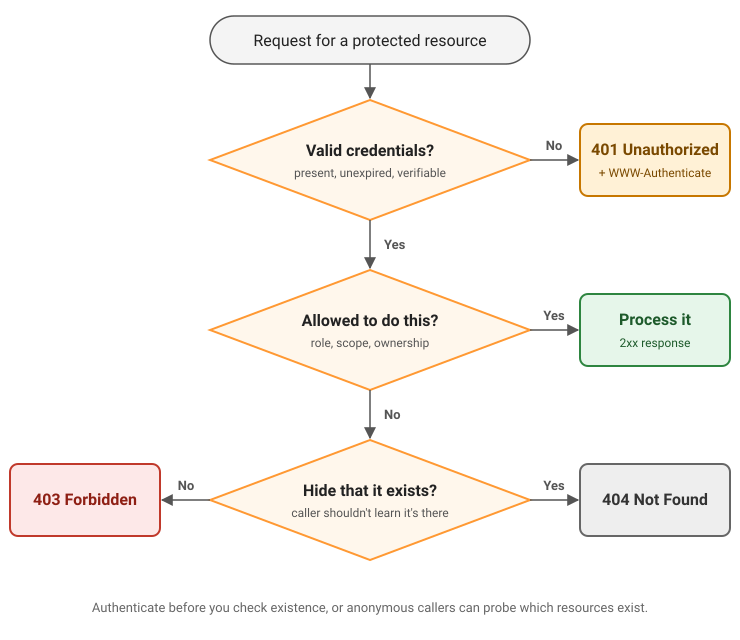

**401 Unauthorized means the server could not authenticate the request: it carried no credentials, or its credentials were wrong, expired or invalid. 403 Forbidden means the server understood the request and refuses it, typically because the caller is authenticated but does not have permission.** The one-line rule is *401 = not authenticated, 403 = authenticated but not allowed*. A 401 must include a `WWW-Authenticate` header that tells the client how to authenticate, and retrying with valid credentials can succeed. Retrying a 403 with the same credentials will not.

*Last updated 2 November 2026. Definitions checked against [RFC 9110](https://www.rfc-editor.org/rfc/rfc9110.html) (HTTP Semantics), [RFC 6750](https://www.rfc-editor.org/rfc/rfc6750.html) (OAuth 2.0 Bearer Token Usage) and the official documentation of each framework below.*

## Table of contents

- [The decision flowchart](#the-decision-flowchart)
- [What RFC 9110 says](#what-rfc-9110-says)
- [401 vs 403 vs 404 comparison table](#401-vs-403-vs-404-comparison-table)
- [How to return 401 and 403 in popular frameworks](#how-to-return-401-and-403-in-popular-frameworks)
- [Common mistakes and edge cases](#common-mistakes-and-edge-cases)
- [How 401 and 403 map to sessions, JWTs and roles](#how-401-and-403-map-to-sessions-jwts-and-roles)
- [Frequently Asked Questions](#frequently-asked-questions)

## The decision flowchart

Choosing between 401, 403 and 404 comes down to three questions, asked in order.



The same logic in plain text:

1. **Does the request carry valid credentials?** If there are none, or the password is wrong, or the token is expired, revoked, malformed or has a bad signature, return **401 Unauthorized** with a `WWW-Authenticate` header.
2. **Is this identity allowed to do this to this resource?** Check role, scope, ownership or any other policy. If yes, process the request and return a 2xx.
3. **If not, should the caller learn that the resource exists?** If revealing it would leak information (another tenant's invoice, a private repository), return **404 Not Found**. Otherwise return **403 Forbidden**.

Order matters. Authenticate before you look up the resource. If an anonymous caller gets 404 for missing IDs and 401 for real ones, they can enumerate which resources exist.

## What RFC 9110 says

[RFC 9110](https://www.rfc-editor.org/rfc/rfc9110.html), published in June 2022, is the current definition of HTTP semantics. It replaced RFC 7231 and RFC 7235, which older articles still cite for 401 and 403.

### 401 Unauthorized (Section 15.5.2)

[Section 15.5.2](https://www.rfc-editor.org/rfc/rfc9110.html#section-15.5.2) says a 401 means the request "lacks valid authentication credentials for the target resource." It also sets a hard requirement: the server **MUST** send a `WWW-Authenticate` header with at least one challenge. If the request did include credentials, the 401 means those credentials were refused, and the client may retry with new ones.

### 403 Forbidden (Section 15.5.4)

[Section 15.5.4](https://www.rfc-editor.org/rfc/rfc9110.html#section-15.5.4) defines 403 as the server having "understood the request but refuses to fulfill it." If credentials were sent, the server considers them insufficient, and the client should not automatically retry with the same ones. The RFC also notes that a request "might be forbidden for reasons unrelated to the credentials", such as an IP allowlist or a geo-block.

The same section gives explicit permission to hide resources: a server that wants to hide that a forbidden resource exists "MAY instead respond with a status code of 404 (Not Found)."

### 404 Not Found (Section 15.5.5)

[Section 15.5.5](https://www.rfc-editor.org/rfc/rfc9110.html#section-15.5.5) covers both cases. A 404 means the server did not find the resource *or* "is not willing to disclose that one exists." Using 404 to hide a resource is therefore within the spec, not a hack.

### The tie-breaker (Section 11.4)

When in doubt, [Section 11.4](https://www.rfc-editor.org/rfc/rfc9110.html#section-11.4) settles it. For a request that omits credentials or contains invalid ones ("e.g., a bad password"), the server SHOULD send a 401 with a `WWW-Authenticate` challenge. And "a server that receives valid credentials that are not adequate to gain access ought to respond with the 403 (Forbidden) status code."

## 401 vs 403 vs 404 comparison table

| | 401 Unauthorized | 403 Forbidden | 404 Not Found |
|---|---|---|---|
| **Meaning** | Not authenticated: no valid credentials | Understood, but refused | Not found, or the server won't say |
| **The question it answers** | "Who are you?" | "I know who you are, and no." | "There is nothing here for you." |
| **Typical trigger** | Missing token, wrong password, expired or revoked token | Wrong role, missing scope, not the owner, CSRF check failed, IP blocked | Resource doesn't exist, or exists but is hidden from this caller |
| **Will retrying with credentials help?** | Yes, with valid credentials | Not with the same credentials. Only different credentials or a permission change | No, unless the resource is created or access is granted |
| **Required headers** | `WWW-Authenticate` (MUST) | None required. Bearer APIs often add `WWW-Authenticate` with `insufficient_scope` | None |
| **Example** | `GET /me` with an expired access token | A `viewer` calling `DELETE /users/42` | `GET /orgs/acme/invoices/981` from a user outside the Acme org |

## How to return 401 and 403 in popular frameworks

The pattern is the same everywhere: **authenticate first** and return 401 with a challenge if that fails, then **authorize** and return 403 if that fails. In the examples, `verifyToken` / `verify_token` stands in for your session or JWT verification and returns `null` / `None` when the token is missing, expired or invalid.

### Express (Node.js)

Express has no built-in auth, so you write two middlewares: one for authentication and one for authorization. `res.set()` adds the challenge header and `res.status()` sets the code.

```js
const express = require("express");
const app = express();

// Authentication: who is calling?
async function requireAuth(req, res, next) {
  const [scheme, token] = (req.get("Authorization") || "").split(" ");

  if (scheme?.toLowerCase() !== "bearer" || !token) {
    // No usable credentials: send a challenge, no error code (RFC 6750 §3.1)
    res.set("WWW-Authenticate", 'Bearer realm="api"');
    return res.status(401).json({ error: "authentication_required" });
  }

  const user = await verifyToken(token); // null if expired, revoked or malformed
  if (!user) {
    res.set("WWW-Authenticate", 'Bearer realm="api", error="invalid_token"');
    return res.status(401).json({ error: "invalid_token" });
  }

  req.user = user;
  next();
}

// Authorization: is this caller allowed to do this?
function requireRole(role) {
  return (req, res, next) => {
    if (!req.user.roles.includes(role)) {
      return res.status(403).json({ error: "forbidden", message: `Requires the '${role}' role` });
    }
    next();
  };
}

app.delete("/users/:id", requireAuth, requireRole("admin"), async (req, res) => {
  await deleteUser(req.params.id);
  res.status(204).end();
});
```

This works on Express 4 and 5. In Express 5, a rejected promise in async middleware is passed to `next(err)` automatically, so a `verifyToken` that throws becomes a 500, not a silent hang.

### Next.js (App Router)

Do the real checks in the Route Handler. Next.js 16 renamed `middleware.ts` to [`proxy.ts`](https://nextjs.org/docs/app/api-reference/file-conventions/proxy), and the [Next.js authentication guide](https://nextjs.org/docs/app/guides/authentication) is clear that Proxy is for optimistic checks and "should not be your only line of defense."

```ts
// app/api/projects/[id]/route.ts
import { NextResponse } from "next/server";
import { getSession } from "@/lib/session"; // verifies the session cookie or bearer token

export async function DELETE(
  request: Request,
  { params }: { params: Promise<{ id: string }> }
) {
  const session = await getSession(request);

  if (!session) {
    return NextResponse.json(
      { error: "authentication_required" },
      { status: 401, headers: { "WWW-Authenticate": 'Bearer realm="api"' } }
    );
  }

  if (!session.roles.includes("admin")) {
    return NextResponse.json({ error: "forbidden" }, { status: 403 });
  }

  const { id } = await params;
  await deleteProject(id);
  return new Response(null, { status: 204 });
}
```

The official guide's example returns a bare 401 with no `WWW-Authenticate` header, so add one yourself, as above. For pages rather than APIs, Next.js has [`unauthorized()` and `forbidden()`](https://nextjs.org/docs/app/api-reference/functions/forbidden), which render 401 and 403 pages. They are still experimental and need `experimental.authInterrupts` enabled.

### FastAPI (Python)

```python
from typing import Annotated

from fastapi import Depends, FastAPI, HTTPException, status
from fastapi.security import HTTPAuthorizationCredentials, HTTPBearer

app = FastAPI()
bearer = HTTPBearer(auto_error=False)  # we build the 401 ourselves


def get_current_user(
    credentials: Annotated[HTTPAuthorizationCredentials | None, Depends(bearer)],
):
    if credentials is None:
        raise HTTPException(
            status_code=status.HTTP_401_UNAUTHORIZED,
            detail="Not authenticated",
            headers={"WWW-Authenticate": 'Bearer realm="api"'},
        )
    user = verify_token(credentials.credentials)
    if user is None:
        raise HTTPException(
            status_code=status.HTTP_401_UNAUTHORIZED,
            detail="Invalid or expired token",
            headers={"WWW-Authenticate": 'Bearer realm="api", error="invalid_token"'},
        )
    return user


def require_role(role: str):
    def check(user: Annotated[dict, Depends(get_current_user)]):
        if role not in user["roles"]:
            raise HTTPException(
                status_code=status.HTTP_403_FORBIDDEN,
                detail=f"Requires the '{role}' role",
            )
        return user

    return check


@app.delete("/users/{user_id}", status_code=204)
def delete_user(user_id: int, user: Annotated[dict, Depends(require_role("admin"))]):
    ...
```

Two version notes. Before [FastAPI 0.122.0](https://fastapi.tiangolo.com/how-to/authentication-error-status-code/) (November 2025), the built-in security classes such as `HTTPBearer` returned **403** when credentials were missing; they now return 401 with a `WWW-Authenticate` header. Also, FastAPI's [OAuth2 scopes tutorial](https://fastapi.tiangolo.com/advanced/security/oauth2-scopes/) raises 401 for "Not enough permissions". RFC 6750 says an `insufficient_scope` error should be a 403, so return 403 when the token is valid but lacks the scope.

### Django REST Framework

DRF has the best-known 401/403 quirk. Whether an unauthenticated request gets a 401 or a 403 depends on the [first authentication class on the view](https://www.django-rest-framework.org/api-guide/authentication/#unauthorized-and-forbidden-responses). A 401 needs a `WWW-Authenticate` header, and `SessionAuthentication` has no challenge to send, so it produces a **403**. DRF's default setting lists `SessionAuthentication` first, so an out-of-the-box API returns 403 with the body "Authentication credentials were not provided."

To get correct 401s for token clients, put a class with a challenge first (`TokenAuthentication`, `BasicAuthentication`, or your own class that implements `authenticate_header()`):

```python
from rest_framework.authentication import SessionAuthentication, TokenAuthentication
from rest_framework.permissions import IsAdminUser, IsAuthenticated
from rest_framework.response import Response
from rest_framework.views import APIView


class AdminReport(APIView):
    # TokenAuthentication sends "WWW-Authenticate: Token", so anonymous requests get a 401
    authentication_classes = [TokenAuthentication, SessionAuthentication]
    permission_classes = [IsAuthenticated, IsAdminUser]

    def get(self, request):
        return Response({"ok": True})
```

With this view, no token or a bad token returns 401, a valid non-staff user gets 403, and a staff user gets 200. An authenticated request that fails a permission check is always a 403, whatever the authentication class.

### Spring Security (Java)

Spring Security makes the 401/403 split for you. Its [`ExceptionTranslationFilter`](https://docs.spring.io/spring-security/reference/servlet/architecture.html#servlet-exceptiontranslationfilter) sends unauthenticated requests to an `AuthenticationEntryPoint` (a login redirect or a `WWW-Authenticate` challenge) and authenticated-but-denied requests to an `AccessDeniedHandler`. For a JWT resource server:

```java
@Configuration
@EnableWebSecurity
public class SecurityConfig {

    @Bean
    SecurityFilterChain api(HttpSecurity http) throws Exception {
        http
            .authorizeHttpRequests(auth -> auth
                .requestMatchers(HttpMethod.GET, "/messages/**").hasAuthority("SCOPE_message:read")
                .anyRequest().authenticated())
            .oauth2ResourceServer(oauth2 -> oauth2.jwt(Customizer.withDefaults()));
        return http.build();
    }
}
```

A missing or invalid token gets a 401 with `WWW-Authenticate: Bearer` from `BearerTokenAuthenticationEntryPoint`. A valid token without `message:read` gets a 403 from `BearerTokenAccessDeniedHandler`, which adds an RFC 6750 `insufficient_scope` error. Scopes in the JWT become [`SCOPE_`-prefixed authorities](https://docs.spring.io/spring-security/reference/servlet/oauth2/resource-server/jwt.html), which is why the rule says `SCOPE_message:read`.

## Common mistakes and edge cases

### Returning 403 for a missing or expired token

This is the most common mistake, and it breaks clients. A client that gets a 401 knows to refresh its token or send the user to log in. A 403 tells it that retrying won't help, so it shows an "access denied" screen to a user whose session simply expired. Expired, revoked, malformed and wrongly signed tokens are all 401s.

### Returning 401 for a role or scope failure

This is the mirror image. If the token is valid but the user isn't an admin, a 401 invites the client to re-authenticate in a loop that can never succeed. Use 403.

### Wrong password on a login form

A wrong password is an authentication failure, so it is never a 403. RFC 9110 names "a bad password" as a 401 case. Login endpoints that take credentials in a form body (not an `Authorization` header) commonly return 401 too, or 400. The OAuth 2.0 token endpoint returns 400 with `invalid_grant` ([RFC 6749, Section 5.2](https://www.rfc-editor.org/rfc/rfc6749.html#section-5.2)). Whatever you choose, use the same response for "unknown user" and "wrong password" so attackers can't enumerate accounts.

### Hiding resources: 403 or 404?

Use 404 when the existence of a resource is itself sensitive, such as another customer's order or a private repository. Use 403 when the caller already knows the resource exists and telling them why they can't act on it helps, for example "only owners can delete this project." An easy way to get 404s right is to scope queries to the caller (`WHERE org_id = :caller_org`), so out-of-scope rows are never found.

### Rate limiting: 429, not 403

Throttling is not an authorization decision. [RFC 6585](https://www.rfc-editor.org/rfc/rfc6585.html#section-4) defines 429 Too Many Requests for rate limiting, and you can add a `Retry-After` header. Returning 403 makes a temporary condition look permanent.

### CSRF failures return 403

CSRF protection usually rejects a forged request with a 403. [Django](https://docs.djangoproject.com/en/5.2/ref/csrf/), for example, returns a 403 when the CSRF token is missing or wrong. That fits the definition: the session cookie is valid, so the user is authenticated, but the request itself is refused. If you see unexpected 403s on `POST` requests from a logged-in browser, check the CSRF token before checking roles.

### OAuth 2.0 bearer-token errors

[RFC 6750, Section 3.1](https://www.rfc-editor.org/rfc/rfc6750.html#section-3.1) maps bearer-token failures to status codes and an `error` value in the `WWW-Authenticate` header:

| Situation | Status | `error` value |
|---|---|---|
| No token sent at all | 401 | none: just the challenge, e.g. `Bearer realm="api"` |
| Malformed request (e.g. token sent in both the header and the body) | 400 | `invalid_request` |
| Token expired, revoked, malformed or invalid | 401 | `invalid_token` |
| Valid token, but missing a required scope | 403 | `insufficient_scope` (may include `scope="..."`) |

For example, the response to an expired token looks like this:

```http
HTTP/1.1 401 Unauthorized
WWW-Authenticate: Bearer realm="api", error="invalid_token", error_description="The access token expired"
```

## How 401 and 403 map to sessions, JWTs and roles

In a real app, the two codes line up with the two halves of auth: [authentication versus authorization](https://supertokens.com/blog/authentication-vs-authorization).

- **Sessions.** No session cookie, or a session that has expired or been revoked, is a 401. The frontend should send the user to log in. See [session-based authentication](https://supertokens.com/blog/session-based-authentication) for how sessions are verified.
- **Access tokens and JWTs.** A short-lived access token that has expired is a 401, which tells the client to use its refresh token and retry. Because a [JWT](https://supertokens.com/blog/what-is-jwt) is verified locally, a revoked JWT keeps passing signature checks until it expires unless you [add a revocation check](https://supertokens.com/blog/revoking-access-with-a-jwt-blacklist). When that check fails, it is also a 401. For where JWTs fit relative to OAuth, see [OAuth vs JWT](https://supertokens.com/blog/oauth-vs-jwt).
- **Roles and permissions.** A valid session without the right role or permission is a 403. With [RBAC](https://supertokens.com/blog/what-is-roles-based-access-control-vs-abac) this is a single check after authentication, and it should run on every request, not only in the UI.

Keeping that split consistent is what lets a client tell "refresh and retry" apart from "show an access-denied message". SuperTokens follows it by default: a missing session or an expired access token returns 401, and a failed role or permission check returns 403 with the failed claims in the body. If you're wiring this up yourself, the SuperTokens docs on [protecting API routes](https://supertokens.com/docs/additional-verification/session-verification/protect-api-routes) and [customizing session error handling](https://supertokens.com/docs/post-authentication/session-management/advanced-workflows/customize-error-handling) show both paths.

## Frequently Asked Questions

### Is 401 or 403 correct for a wrong password?

401, never 403. RFC 9110 Section 11.4 lists a bad password as invalid credentials, which call for a 401 with a `WWW-Authenticate` challenge. Some login endpoints return 400 instead (the OAuth token endpoint uses 400 `invalid_grant`), but a wrong password is an authentication failure, not an authorization one.

### Should I return 403 or 404 for resources a user shouldn't know exist?

Return 404. RFC 9110 explicitly allows a server to answer 404 instead of 403 to hide that a forbidden resource exists, and its definition of 404 includes being "not willing to disclose that one exists." Use 403 when the caller already knows the resource is there.

### Why does 401 say "Unauthorized" if it means unauthenticated?

It's a historical naming mistake that the spec never renamed. The definition has always been about authentication: the request "lacks valid authentication credentials." In practice, read 401 as "unauthenticated" and 403 as "unauthorized."

### Does a 401 response require a WWW-Authenticate header?

Yes. RFC 9110 says a server generating a 401 MUST send a `WWW-Authenticate` header with at least one challenge, such as `Bearer realm="api"` or `Basic realm="admin"`. Hand-written handlers, and even some official framework examples, leave it out, so check your responses.

### What status should an expired token return?

401 Unauthorized. RFC 6750 defines an expired, revoked or malformed bearer token as `invalid_token` and says the server should respond with 401, after which the client may get a new token and retry. Returning 403 tells the client that retrying won't help, which is wrong for an expired token.

### What's the difference between 403 and 405?

403 Forbidden means this caller isn't allowed to perform the request. 405 Method Not Allowed means the resource doesn't support that HTTP method for anyone, such as a `DELETE` on a read-only endpoint. A 405 must include an `Allow` header listing the supported methods.

### Should rate limiting return 403 or 429?

429 Too Many Requests, defined in RFC 6585. It tells the client the condition is temporary, and a `Retry-After` header can say when to try again. A 403 suggests the client will never be allowed.

### Why does Django REST Framework return 403 instead of 401?

DRF returns 401 only if the first authentication class on the view provides a `WWW-Authenticate` challenge. The default first class, `SessionAuthentication`, has none, so unauthenticated requests get a 403. Put `TokenAuthentication`, `BasicAuthentication` or a custom class with `authenticate_header()` first to get 401s.

## Related reading

- [Authentication vs Authorization: What's the Difference?](https://supertokens.com/blog/authentication-vs-authorization)
- [What Is a 502 Bad Gateway Error and How to Fix It](https://supertokens.com/blog/what-is-502-bad-gateway-error)
- [How to Fix CORS Errors](https://supertokens.com/blog/cors-errors)
- [Session-Based Authentication: How It Works](https://supertokens.com/blog/session-based-authentication)
