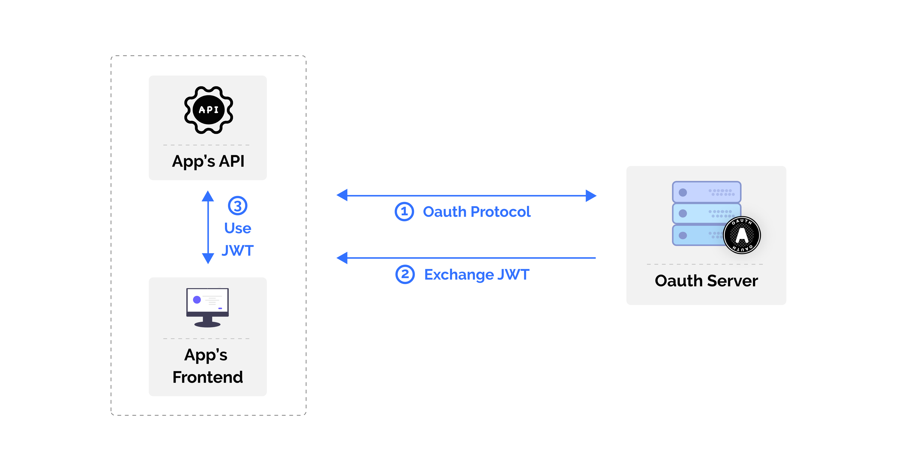
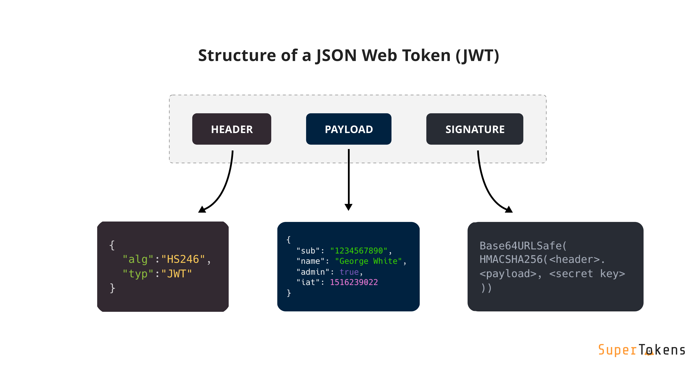

**OAuth and JWT are not alternatives to each other.** OAuth is an *authorization framework*: a set of flows that decide who gets an access token and what it can do. JWT (JSON Web Token) is a *token format*: a signed, self-contained way to carry claims. OAuth can issue JWTs as access tokens, but it can just as easily issue opaque tokens, and you can use JWTs without OAuth at all. The real decisions are whether you need delegated access (OAuth), and whether your tokens should be self-contained (JWT) or reference server-side state (opaque).

## Table of Contents

- [Introduction](#introduction)
- [OAuth vs JWT: Comparison Overview](#oauth-vs-jwt-comparison-overview)
- [What is OAuth?](#what-is-oauth)
- [What is JWT?](#what-is-jwt)
- [Key Differences Between OAuth and JWT](#key-differences-between-oauth-and-jwt)
- [Advantages and Disadvantages of OAuth](#advantages-and-disadvantages-of-oauth)
- [Advantages and Disadvantages of JWT](#advantages-and-disadvantages-of-jwt)
- [When to Use OAuth](#when-to-use-oauth)
- [When to Use JWT](#when-to-use-jwt)
- [Can OAuth and JWT be used together?](#can-oauth-and-jwt-be-used-together)
- [JWT vs Opaque Tokens](#jwt-vs-opaque-tokens)
- [What Changed for OAuth and JWT in 2026](#what-changed-for-oauth-and-jwt-in-2026)
- [JWT and OAuth Security Best Practices](#jwt-and-oauth-security-best-practices)
- [Experience Seamless Authentication with OAuth and JWT Integration!](#experience-seamless-authentication-with-oauth-and-jwt-integration)
- [Conclusion](#conclusion)
- [Frequently Asked Questions](#frequently-asked-questions)

## Introduction

OAuth and JWT come up together in almost every conversation about API security, which is why they are so often compared, and so often confused. One defines *how access is granted*; the other defines *what a token looks like*.

In this guide, updated for 2026, we compare the two side by side, explain how they work together, and cover the question that usually matters more in practice: should your access tokens be JWTs or opaque tokens? We also cover what has changed in OAuth since this post was first published, including OAuth 2.1 and the current OAuth security best practices.

Whether you're building your first app or you're a seasoned pro looking to brush up on your knowledge, this guide will help you understand when and how to use OAuth and JWT. Let's get started!

## OAuth vs JWT: Comparison Overview

Before we dive into the nitty-gritty details, let's take a bird's-eye view of how OAuth and JWT stack up against each other:

| Dimension | OAuth | JWT |
| --------- | ----- | --- |
| What it is | An authorization framework (a set of flows and roles) | A token format (a signed JSON object) |
| Primary Use | Authorization and delegated access to APIs | Carrying verifiable claims between parties (sessions, access tokens, ID tokens) |
| Protocol Standards | OAuth 2.0 (RFC 6749), OAuth 2.1 (IETF draft), security BCP (RFC 9700); OpenID Connect adds authentication on top | JSON Web Token (RFC 7519), signed with JWS (RFC 7515), optionally encrypted with JWE (RFC 7516) |
| Workflow | Multi-step flows, such as Authorization Code with PKCE and Client Credentials | Simple sign-and-verify: the issuer signs, the receiver verifies |
| Token format | Not specified: access tokens can be JWTs or opaque strings | Always a JWT (`header.payload.signature`) |
| SSO (Single Sign-On) | Common foundation for SSO, usually via OpenID Connect | Used inside SSO (for example, as the OIDC ID token), but not an SSO protocol by itself |
| Validation | Depends on token format: local verification for JWTs, introspection endpoint for opaque tokens | Local signature verification, usually with a public key from a JWKS endpoint |
| Revocation | Supported via the revocation endpoint (RFC 7009); takes effect immediately for opaque tokens | Not revocable before expiry without a denylist or short lifetimes |
| Security Features | Scopes, consent, PKCE, refresh token rotation, sender-constrained tokens | Signature verification, expiry (`exp`), audience (`aud`) and issuer (`iss`) checks, optional encryption |
| Implementation Complexity | Higher: authorization server, clients, resource servers | Lower: a library and a signing key |

Now that we've got a quick comparison, let's dive deeper into each of these technologies.

## What is OAuth?

OAuth, short for "Open Authorization," is an open standard for authorization that lets an application access resources on a user's behalf without ever seeing the user's password. It works for web, mobile, desktop and server-to-server applications. It's like a valet key for your car – it gives limited access to your resources without handing over the full set of keys.

One important nuance: OAuth on its own is about *authorization*, not *authentication*. When you see "Login with Google," the login part is handled by **OpenID Connect (OIDC)**, an identity layer built on top of OAuth 2.0 that adds an ID token (which is a JWT). For more on that distinction, see our guide to [OAuth vs OIDC](https://supertokens.com/blog/oauth-vs-oidc).

### How does OAuth Work?

OAuth works by delegating user authentication to the service that hosts the user account and authorizing third-party applications to access that user account. Here's a simplified version of the Authorization Code flow:

1. The user initiates a request to the application.
2. The application redirects the user to the OAuth provider (the authorization server), including a PKCE code challenge.
3. The user authenticates with the OAuth provider.
4. The OAuth provider asks the user to authorize the application.
5. The user grants permission.
6. The OAuth provider sends an authorization code to the application.
7. The application exchanges the code (and the PKCE code verifier) for an access token, and usually a refresh token.
8. The application uses the access token to access protected resources.

OAuth supports several flows, also called grant types. In 2026, the recommended ones are the **Authorization Code flow with PKCE** for any app with a user (web, mobile, single-page apps) and the **Client Credentials flow** for machine-to-machine access. The older Implicit flow and Resource Owner Password Credentials flow are deprecated by the [OAuth 2.0 Security Best Current Practice (RFC 9700)](https://datatracker.ietf.org/doc/rfc9700/) and removed entirely in OAuth 2.1. For a full breakdown, see [OAuth grant types explained](https://supertokens.com/blog/oauth-grant-types) and [Authorization Code flow with PKCE](https://supertokens.com/blog/authorization-code-flow-with-pkce).

## What is JWT?

JWT stands for JSON Web Token. It's an open standard (RFC 7519) that defines a compact and self-contained way for securely transmitting information between parties as a JSON object. Think of it as a secure postcard – all the information is right there for anyone to read, but only the issuer could have written it, and the recipient can verify that it hasn't been tampered with.

### How does JWT Work?

A JWT consists of three parts: a header, a payload, and a signature. These parts are Base64URL-encoded, separated by dots, and typically look something like this: `xxxxx.yyyyy.zzzzz`

Here's a breakdown of each part:
- **Header**: Contains metadata about the token, including the type of token and the signing algorithm used (for example, `RS256` or `ES256`).
- **Payload**: Contains claims (statements about the user, such as `sub`, plus registered claims like `exp`, `iss` and `aud`) and additional data.
- **Signature**: Ensures that the token hasn't been altered and was issued by a trusted party.

The process works like this:
1. The server generates a JWT by encoding the header and payload and signing them, either with a shared secret (HMAC, such as `HS256`) or, more commonly in distributed systems, with a private key (such as `RS256` or `ES256`).
2. The JWT is sent to the client.
3. The client sends the JWT back to the server with subsequent requests.
4. The server verifies the signature (with the shared secret or the issuer's public key, often fetched from a JWKS endpoint), checks the expiry, issuer and audience, and, if all are valid, processes the request.

Note that a standard signed JWT is *encoded, not encrypted*. Anyone who gets hold of the token can decode and read its payload, so never put secrets or sensitive personal data in it.

For a deep dive into the structure and functionality of JWTs, check out this detailed guide on [What is JWT](https://supertokens.com/blog/what-is-jwt).

## Key Differences Between OAuth and JWT

### Difference 1 - Use Cases and Purpose

- **OAuth**: Primarily used for authorization and delegating access. It's great when you need to grant third-party applications (or your own apps and services) limited access to user resources without sharing credentials.
- **JWT**: Used to carry verifiable claims. It's perfect for stateless verification in web applications, especially in microservices architectures, and it's the format used for OIDC ID tokens and many OAuth access tokens.

### Difference 2 - Implementation and Complexity

- **OAuth**: Involves a multi-step process with different roles (client, resource owner, authorization server, resource server). It's more complex but offers more flexibility.
- **JWT**: Simpler to implement as it's self-contained. The token itself carries all necessary information, making it easier to use in stateless applications.

### Difference 3 - Security and Management

- **OAuth**: Offers fine-grained access control through scopes, user consent, and a standard way to revoke tokens. How quickly a revocation takes effect depends on the token format: opaque access tokens stop working immediately, while JWT access tokens remain valid until they expire.
- **JWT**: Relies on cryptographic signatures for security. Once issued, JWTs are valid until they expire, which can be a security concern if not managed properly. This is why JWT access tokens are usually short-lived and paired with refresh tokens.

## Advantages and Disadvantages of OAuth

### Advantages of OAuth

- **Fine-grained access control**: OAuth's scope mechanism allows for precise control over what resources a third-party application can access. This granularity enhances security and user privacy by limiting exposure to only necessary data.
- **Support for Single Sign-On (SSO)**: Combined with OpenID Connect, OAuth enables seamless SSO across multiple applications and domains. Users can authenticate once and access various services without repeatedly entering credentials.
- **Robust security features**: OAuth includes built-in security measures like token expiration, revocation, PKCE and refresh token rotation. This allows for quick mitigation of potential security breaches by invalidating compromised tokens.
- **Standardized protocol**: As an industry-standard protocol, OAuth ensures interoperability across different platforms and services. This standardization simplifies integration with various third-party services.

### Disadvantages of OAuth

- **Complex implementation**: Setting up OAuth can be challenging, especially for smaller projects or teams with limited resources. The multi-step flow and various roles involved require careful planning and implementation.
- **Overhead from multiple components**: OAuth's architecture involves multiple components (authorization server, resource server, client), which can increase system complexity and potential points of failure.
- **Performance considerations**: The additional steps in the OAuth flow, such as code exchange and, for opaque tokens, introspection calls on each request, can introduce latency compared to simpler authentication methods.
- **Easy to misconfigure**: Many real-world OAuth vulnerabilities come from loose redirect URI matching, missing PKCE or `state` checks, or overly broad scopes, rather than from the protocol itself.

## Advantages and Disadvantages of JWT

### Advantages of JWT

- **Simplicity and ease of use**: JWTs are self-contained and don't require server-side storage, making them straightforward to implement and use in various scenarios.
- **Compact and self-contained**: All necessary information is encoded within the token itself, reducing the need for database lookups and improving performance in distributed systems.
- **Ideal for stateless applications**: JWTs fit perfectly into modern stateless architectures, especially in microservices environments where maintaining session state can be challenging.
- **Cross-domain / CORS**: Since JWTs are self-contained, they work well across different domains, making them suitable for single-page applications and mobile apps that interact with backend APIs. (If you're sending tokens across origins, make sure your CORS configuration is correct: see our guide to [fixing CORS errors](https://supertokens.com/blog/cors-errors).)

### Disadvantages of JWT

- **Stateless nature limitations**: Once issued, JWTs cannot be easily revoked before their expiration time. This can be a security concern if a token is compromised. Workarounds such as a [JWT blacklist](https://supertokens.com/blog/revoking-access-with-a-jwt-blacklist) reintroduce server-side state.
- **Potential security risks**: Improper handling of JWTs can lead to vulnerabilities, such as accepting the `none` algorithm or confusing symmetric and asymmetric keys. Storing sensitive information in the payload (which is Base64URL-encoded, not encrypted) can expose data if the token is intercepted.
- **Token size**: As all information is contained within the token, JWTs can become quite large, especially with many claims. This can impact performance when tokens are sent with every request, and can exceed cookie or header size limits.
- **Lack of fine-grained control**: Unlike OAuth's scope mechanism, standard JWTs don't inherently provide a way to control access at a granular level without custom claims and checks.

## When to Use OAuth

**OAuth shines in scenarios like:**

- **Third-party application access**: When you want to allow external apps to access user data on their behalf (think "Login with Google" or allowing a third-party app to post on your social media).
- **Implementing SSO**: For seamless user experience across multiple applications within an organization, usually via OpenID Connect.
- **Scenarios requiring fine-grained access control**: When you need to limit what resources a third-party can access and for how long.
- **Machine-to-machine and AI agent access**: When services, scripts or AI agents need scoped, auditable access to your APIs, using the Client Credentials flow or delegated user consent.

## When to Use JWT

JWT is ideal for:

- **Stateless authentication**: Perfect for web and mobile apps where you don't want to look up session information on every request.
- **Secure data transmission**: When you need to send verifiable claims between parties.
- **Microservices communication**: For authenticating requests between services in a distributed system, where each service can verify tokens with a public key instead of calling a central server.

For a more detailed comparison of authentication solutions, including OAuth providers, check out this article on [Auth0 Alternatives](https://supertokens.com/blog/auth0-alternatives).

## Can OAuth and JWT be used together?

Absolutely! In fact, OAuth and JWT often complement each other beautifully. OAuth 2.0 can use JWTs as access tokens, combining OAuth's robust authorization framework with JWT's compact, self-contained nature. There's even a standard for it: [RFC 9068, the JWT Profile for OAuth 2.0 Access Tokens](https://datatracker.ietf.org/doc/rfc9068/), which defines the required claims and the `at+jwt` token type so that access tokens from different vendors look and validate the same way.

Here's how they can work together:
1. OAuth handles the authorization process and issues access tokens.
2. These access tokens can be JWTs, containing claims about the user and their permissions.
3. The resource server can then validate these JWT access tokens without needing to contact the authorization server for every request.

This combination offers several benefits:

- Reduced load on authorization servers
- Improved performance in distributed systems
- Enhanced security through JWT's signature verification

A practical example might look like this:

- A user logs in to your application using OAuth (say, "Login with Google").
- Your authorization server creates a JWT containing user info and permissions.
- This JWT is used as the access token for subsequent API requests.
- Your API can verify the JWT's signature and extract user info without additional database lookups.

To learn more about advanced token usage, including JWKs (JSON Web Key Sets), check out this guide on [Understanding JWKS](https://supertokens.com/blog/understanding-jwks).

But JWTs are only one option for OAuth access tokens. Which brings us to the comparison that often matters more in practice.

## JWT vs Opaque Tokens

The OAuth 2.0 specification deliberately **does not mandate a token format**. An access token can be a JWT, or it can be an **opaque token**. Opaque tokens are actually the more traditional choice in OAuth, and many authorization servers still issue them by default. JWT access tokens are a popular, but optional, optimization.

### What is an opaque token?

An opaque token is a random, unguessable string, such as `8f3b1c9e2a7d4f60b5e1...`, that has no meaning on its own. It is simply a reference to state stored on the server: the user, the scopes granted, the expiry and whether it has been revoked. To find out what an opaque token means, the resource server has to ask, either by looking it up in a shared database or by calling the authorization server's **token introspection endpoint** ([RFC 7662](https://datatracker.ietf.org/doc/rfc7662/)), typically at a path like `/introspect`.

A JWT, by contrast, is self-contained: everything the resource server needs is inside the token, and it can be verified locally with the issuer's public key.

### JWT vs opaque tokens: comparison

| Dimension | JWT | Opaque token |
| --------- | --- | ------------ |
| Structure | Self-contained, decodable JSON claims plus a signature | Random identifier that references server-side state |
| Validation | Local signature check, no network call | Introspection endpoint or database lookup on every request (often cached) |
| State | Stateless | Stateful |
| Revocation | Not revocable before expiry without a denylist; relies on short lifetimes | Instant: delete or mark the server-side record and the token stops working |
| Payload exposure | Claims are Base64URL-encoded and readable by anyone who intercepts the token | Reveals nothing if intercepted |
| Size | Grows with every claim; often 500 bytes to several KB | Small and fixed-size, typically 32 to 64 characters |
| Performance at scale | Fast to verify; no dependency on the authorization server per request | Adds latency and load on the authorization server, unless cached |
| Typical use | Distributed systems, microservices, third-party-facing APIs, ID tokens | First-party and internal APIs that need tight revocation control, refresh tokens |

### How opaque tokens and JWTs fit into OAuth

- **Opaque access tokens** are validated through token introspection (RFC 7662) and can be revoked instantly through the revocation endpoint ([RFC 7009](https://datatracker.ietf.org/doc/rfc7009/)). This is simple and safe, but puts the authorization server on the hot path of every API call.
- **JWT access tokens** (RFC 9068) let each resource server validate tokens on its own, which scales well, at the cost of revocation only taking effect when the token expires.
- **Refresh tokens are almost always opaque.** They are only ever sent back to the authorization server, which already holds the state, so there's no benefit to making them self-contained, and every benefit to being able to revoke them instantly.

This is why the most common pattern in production is a **hybrid**: short-lived JWT access tokens (minutes) for fast, stateless validation, plus long-lived opaque refresh tokens that are stored server-side, rotated on every use and revocable at any time. You get the performance of JWTs with a revocation window no longer than the access token's lifetime.

### When to choose opaque tokens

Opaque tokens are the better choice for:

- **First-party and internal APIs** where the API and the authorization server live close together and a lookup is cheap.
- **Tight revocation control**, such as banking, healthcare or admin tools, where a logout, password change or suspicious activity must cut off access immediately.
- **Sensitive claims**, when you don't want user data or permissions to be readable by the client or anyone who intercepts the token.
- **Refresh tokens**, in almost every architecture.

### When to choose JWT tokens

JWTs are the better choice for:

- **Distributed systems and microservices**, where many services need to verify tokens without calling a central server.
- **Third-party-facing APIs**, where resource servers are run by different teams or vendors and a standard format (RFC 9068) helps interoperability.
- **High-throughput APIs**, where an introspection call per request would be too slow or too costly.
- **Short-lived access tokens**, where a few minutes of validity after revocation is an acceptable trade-off.

## What Changed for OAuth and JWT in 2026

If you last looked at OAuth and JWT a couple of years ago, here's what has changed:

- **OAuth 2.1 is the de facto baseline.** OAuth 2.1 is still an IETF Internet-Draft (draft 16 was published in September 2026, and the working group is targeting submission to the IESG in December 2026), but its rules are already the standard guidance. It consolidates OAuth 2.0 and its security extensions into one document: PKCE is required for the Authorization Code flow, the Implicit and Password grants are removed, redirect URIs must match exactly, and refresh tokens issued to public clients must be sender-constrained or rotated.
- **RFC 9700 is the security reference.** The OAuth 2.0 Security Best Current Practice was published as [RFC 9700](https://datatracker.ietf.org/doc/rfc9700/) in January 2025. It formally deprecates the Implicit and Password grants and recommends PKCE for all clients.
- **Sender-constrained tokens are going mainstream.** [DPoP (RFC 9449)](https://datatracker.ietf.org/doc/rfc9449/) and mutual TLS (RFC 8705) bind access tokens to a key held by the client, so a stolen token is useless on its own. They are increasingly expected for high-security APIs.
- **Standard JWT access tokens.** RFC 9068 gives JWT access tokens a common shape (`at+jwt` type, required `iss`, `sub`, `aud`, `exp`, `iat`, `client_id` and `jti` claims), which makes it easier to swap identity providers without rewriting token validation.
- **OAuth for AI agents and MCP.** With AI agents calling APIs on users' behalf, OAuth's delegated, scoped access has become the default way to authorize them, including in the Model Context Protocol (MCP). Short-lived, narrowly scoped tokens matter even more when the client is an autonomous agent.

## JWT and OAuth Security Best Practices

Whichever combination you choose, these practices apply in 2026:

1. **Use the Authorization Code flow with PKCE** for every client with a user, including single-page apps and mobile apps. Never use the Implicit or Password grants.
2. **Keep access tokens short-lived** (minutes, not days), and use refresh tokens to get new ones.
3. **Rotate refresh tokens** on every use, and treat reuse of an old refresh token as a sign of theft: revoke the whole session.
4. **Always validate JWTs fully**: check the signature, pin the expected algorithm (never accept `none`), and verify `exp`, `iss` and `aud`. Follow the [JWT Best Current Practices (RFC 8725)](https://datatracker.ietf.org/doc/rfc8725/).
5. **Prefer asymmetric signing** (`RS256` or `ES256`) and publish public keys through a JWKS endpoint, so you can rotate keys without redeploying services.
6. **Don't put sensitive data in JWT payloads.** If claims must be confidential, use opaque tokens or encrypted JWTs (JWE).
7. **Store tokens safely in the browser.** Prefer `HttpOnly`, `Secure`, `SameSite` cookies over `localStorage`, which is readable by any script on the page. See [cookies vs localStorage for sessions](https://supertokens.com/blog/cookies-vs-localstorage-for-sessions-everything-you-need-to-know).
8. **Request the narrowest scopes possible** and register exact redirect URIs.
9. **Protect the login itself.** Tokens are only as trustworthy as the authentication that issued them. Attackers increasingly use automated [OTP bots](https://supertokens.com/blog/otp-bots) to trick users into handing over one-time codes, so pair your token strategy with phishing-resistant MFA where you can.

For a deeper look at the pitfalls of using JWTs for user sessions, read [Are you using JWTs for user sessions in the correct way?](https://supertokens.com/blog/are-you-using-jwts-for-user-sessions-in-the-correct-way)

## Experience Seamless Authentication with OAuth and JWT Integration!
Ready to implement robust authentication in your application? Look no further than SuperTokens! Our solution leverages the power of both OAuth and JWT to provide secure, flexible, and user-friendly authentication.

SuperTokens uses the hybrid pattern described above out of the box: short-lived JWT access tokens that your APIs can verify locally through a JWKS endpoint, paired with opaque, rotating refresh tokens with built-in token theft detection.

With SuperTokens, you get:

- Easy integration of OAuth and social login providers
- Secure JWT session handling with automatic refresh token rotation
- An OAuth2 provider recipe for machine-to-machine and third-party access
- Customizable login flows
- SDKs for popular frameworks
- Open source, with the option to self-host

Don't let authentication be a bottleneck in your development process. [Secure Your App with SuperTokens](https://supertokens.com/) today and experience the difference!

## Conclusion

We've covered a lot of ground, haven't we? Let's recap:
- **OAuth** is an authorization framework, great for delegating access, especially when dealing with third-party applications, SSO, services and AI agents.
- **JWT** is a token format that excels in stateless verification and secure information exchange, perfect for modern web apps and microservices.
- **OAuth access tokens can be JWTs or opaque tokens.** JWTs scale better; opaque tokens are easier to revoke and reveal nothing. Most production systems combine short-lived JWT access tokens with opaque refresh tokens.
- In 2026, **OAuth 2.1 and RFC 9700** set the baseline: PKCE everywhere, no Implicit or Password grants, and rotated or sender-constrained refresh tokens.

Remember, there's no one-size-fits-all solution in the world of authentication and authorization. The best choice depends on your specific use case, security requirements, and application architecture.

So, the next time you're building an app and scratching your head over authentication, you'll know whether to reach for OAuth, JWT, opaque tokens, or a combination of all three!

For more insights on authentication protocols, check out our comparison of [SAML vs OAuth](https://supertokens.com/blog/saml-vs-oauth).

## Frequently Asked Questions

### Is JWT better than OAuth?

Neither is better, because they solve different problems. OAuth is an authorization framework that defines how an application gets permission to access resources. JWT is a token format for carrying signed claims. OAuth can issue JWTs as access tokens, so many systems use both.

### Is a JWT an OAuth token?

A JWT can be an OAuth token, but it doesn't have to be. OAuth 2.0 does not mandate a token format, so access tokens can be JWTs (as defined in RFC 9068) or opaque strings. OpenID Connect ID tokens, on the other hand, are always JWTs.

### What is the difference between a JWT and an opaque token?

A JWT is self-contained: it carries readable claims and a signature, so a server can verify it locally without a database lookup. An opaque token is a random string that references state stored on the server, so it must be checked through an introspection endpoint or database lookup. Opaque tokens can be revoked instantly and reveal nothing if intercepted; JWTs are faster to verify at scale but remain valid until they expire.

### Can a JWT be revoked?

Not directly. A signed JWT stays valid until its `exp` time. To revoke JWTs early, you need a denylist (which reintroduces server-side state), or you keep JWT access tokens short-lived and revoke the opaque refresh token instead, so the user can't obtain new access tokens.

### Should I use OAuth for my own login page?

For first-party login (users signing in directly to your own app), you don't need a full OAuth flow; a secure session with short-lived access tokens and rotating refresh tokens is usually simpler and just as secure. You need OAuth when third-party apps, other services or AI agents need delegated access to your APIs, or when you want users to sign in with external identity providers. See [OAuth 2.0 vs session management](https://supertokens.com/blog/oauth-2-vs-session-management).

### Is OAuth 2.1 a finished standard?

Not yet. As of October 2026, OAuth 2.1 is still an IETF Internet-Draft. However, its requirements (PKCE for all authorization code flows, no Implicit or Password grants, exact redirect URI matching) are already the recommended practice through RFC 9700, so new implementations should follow them today.

## Related reading

- [What is a JWT? Understanding JSON Web Tokens](https://supertokens.com/blog/what-is-jwt)
- [Understanding JWKS](https://supertokens.com/blog/understanding-jwks)
- [OAuth vs OIDC](https://supertokens.com/blog/oauth-vs-oidc)
- [Token-based vs session-based authentication](https://supertokens.com/blog/token-based-authentication-vs-session-based-authentication)
- [Fixing CORS errors](https://supertokens.com/blog/cors-errors)
- [OTP bots: how they work and how to defend against them](https://supertokens.com/blog/otp-bots)
