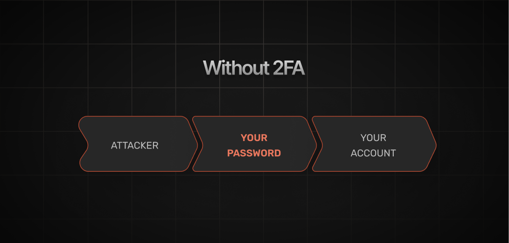
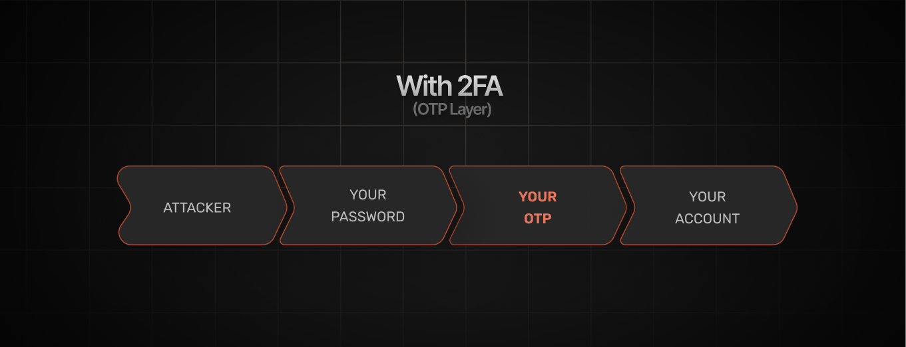
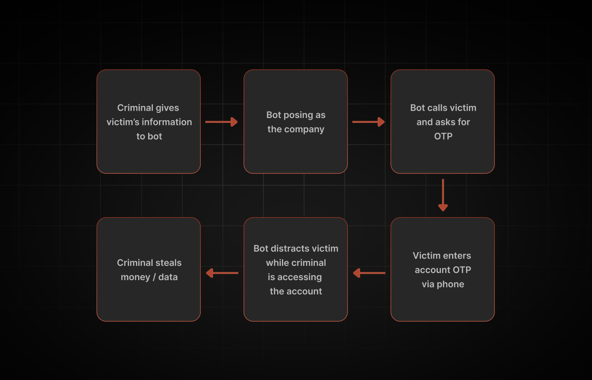

**An OTP bot is an automated tool that calls or texts a victim, pretends to be their bank or another trusted company, and talks them into sharing the one-time code that protects their account. It doesn't break the code; it tricks the person. The strongest defense is phishing-resistant MFA such as passkeys, backed by rate limiting and risk signals.**

*Last updated 23 November 2026. Sources: [Kaspersky's research on OTP bots](https://securelist.com/2fa-phishing/112805/) (June 2024), [NIST SP 800-63B-4](https://csrc.nist.gov/pubs/sp/800/63/b/4/final) (July 2025) and the [European Banking Authority's guidance on dynamic linking](https://www.eba.europa.eu/single-rule-book-qa/qna/view/publicId/2019_4556). This article explains OTP bots so you can recognize and stop them. It doesn't describe how to build or use one.*

You finally switched to **Two-Factor Authentication (2FA)**, feeling secure and ahead of the game. But just as we start winning, cybercriminals move the goalpost by introducing **OTP bots**.

Now imagine you're yelling at your game controller because the NPC just betrayed you in the worst way, when your phone rings. It's "your bank". *"We've detected a suspicious payment. To block it, please read out the code we just sent you."*

Panicked (*and wanting to get back to your game*), you read it out, unaware you've just handed your account to a cyber cockroach. 🪳🔓

That's a typical OTP bot attack. These attacks target individuals, employees and businesses. But don't worry. We don't back down from challenges. 🥊 Let's look at how OTP bots work, how to spot them and, most importantly, how to stop them.

```toc
tight: true
toHeading: 3
```

## Understanding Two-Factor Authentication (2FA) & One-Time Passwords (OTPs) 🔐📲

**Two-Factor Authentication (2FA)** adds a second layer of security on top of your password, very commonly a **One-Time Password (OTP)**.

Authentication generally falls into three categories:</br>
✅ **Something you know** (your password)</br>
✅ **Something you have** (your phone or a security key)</br>
✅ **Something you are** (your fingerprint or face)</br>

Your password is the first layer of security (**something you know**). 2FA strengthens it by requiring a second factor, typically an OTP sent to your phone (**something you have**) or biometric verification (**something you are**).

### Why 2FA Matters
🔴 **Without 2FA**: A hacker only needs to steal your password to access your account.</br>
🟢 **With 2FA (OTP layer)**: Even if your password is compromised, an attacker still needs the second factor, which makes unauthorized access much harder.

</br>

</br>
</br>

Without 2FA, stealing your password is all it takes for an attacker to access your account.

</br>


With 2FA, the second layer (the OTP) **stops** an attacker who only has your password.

### What Are OTPs?
A **One-Time Password (OTP)** is a short, temporary code sent by SMS or email, or generated by an authenticator app, to confirm a login or an action. Each code works once and expires quickly. (For the differences between code types, see [OTP vs TOTP vs HOTP](https://supertokens.com/blog/otp-vs-totp-vs-hotp).)

For years, we've been told that OTP-based 2FA is the ultimate defense. It's still far better than a password alone. But a code that a person can read and type can also be **read out to the wrong person**. That's the gap OTP bots exploit.

## What Are OTP Bots? 🤖

Kaspersky defines it simply: *"An OTP bot is a piece of software programmed to intercept OTPs with the help of social engineering."*

In other words, an OTP bot doesn't crack or guess the code. It **automates the phone call or message** that persuades the real user to hand the code over. That makes OTP bots a form of **social engineering**, run at scale.

OTP bots are sold as a subscription service (sometimes called **crimeware-as-a-service**), so attackers don't need technical skills. Kaspersky found plans priced from **$140 to $420 per week**, often managed through a Telegram bot or a web panel. That low barrier is a big part of why these attacks are common.

Banking, payments, e-commerce, crypto and SaaS accounts are frequent targets, because a single code can unlock money or sensitive data.

> It's important to note that falling for social engineering doesn't mean you're careless. These calls are designed to sound official and to create panic, so even cautious people can be caught off guard.

## How Do OTP Bots Work? 🔍

At a high level, an OTP bot attack combines a stolen password with a convincing call or message.

</br>

</br>

1. **The attacker already has the password.** It usually comes from phishing, a data breach or [credential stuffing](https://supertokens.com/blog/what-is-credential-stuffing).
2. **The attacker starts a login**, which makes the real service send a genuine OTP to the victim.
3. **The bot contacts the victim**, pretending to be the bank or service, often warning about a "suspicious transaction" to create urgency.
4. **The victim shares the code**, believing they're protecting their account.
5. **The attacker uses the code** to finish logging in, often while the bot keeps the victim on the line.

The key point for defenders: **the code itself is real and valid**. The service did everything right, but the code ended up with the wrong person. Anything that can be read aloud or typed (SMS codes, email codes and authenticator app codes) can be phished this way.

### Common Tactics
- **Urgency and fear**: "Your account is being hacked", "A payment of $900 is about to go through".
- **Impersonation**: the call or message uses the company's name, a spoofed caller ID or a familiar sender name.
- **Automated voice calls**: scripted, often professional-sounding calls, sometimes with synthetic voices and multiple languages, which let one attacker target many people.
- **Fake websites paired with bots**: a phishing page captures the password, and the bot follows up to collect the code.

Separately from OTP bots, SMS codes can also be stolen through **SIM swapping** or weaknesses in telephone networks. That's one reason NIST classes SMS and voice codes as a **"restricted"** authenticator in [SP 800-63B-4](https://pages.nist.gov/800-63-4/sp800-63b.html).

## Warning Signs of an OTP Bot Attack 🚩

### For users
- 📞 Someone **calls or texts asking you to read out, type in or forward** a code. Real banks and services don't do this. As Kaspersky puts it, *"Real banks and other companies never use this method to verify the identity of their clients."*
- 📩 You receive a login or verification code **you didn't request**. That usually means someone has your password.
- ⏱️ The caller **pressures you to act right now** or stay on the line.
- 🔁 The code message itself says something like "never share this code", but the caller asks for it anyway.

If this happens: **hang up**, don't share the code, then contact the company through its official app or the number on your card, and change your password.

### For businesses (signals in your logs)
- An OTP is requested for a login from a **new device, new location or suspicious IP**, especially right after a successful password check.
- **Impossible travel**: the code is requested and entered from locations too far apart to be the same person.
- **Unusual OTP volume**: many codes sent to the same phone number, or many accounts triggering codes from the same IP range.
- A login is followed within minutes by **high-risk actions**: changing the email or phone number, adding a new payee, or a large transfer.
- Spikes in support tickets or user reports about **suspicious calls** claiming to be from your company.

## Detection and Mitigation Checklist ✅

Use this checklist to reduce OTP bot risk in your app. The items are ordered roughly from most to least effective.

| Control | What to do | Why it helps against OTP bots |
|---|---|---|
| **Phishing-resistant MFA** | Offer passkeys or security keys (WebAuthn/FIDO2) and encourage users to adopt them | Passkeys are bound to your real website. There's no code for a victim to read out, so an OTP bot has nothing to steal. NIST requires services to offer at least one phishing-resistant option at AAL2. |
| **Transaction binding** | For payments and sensitive changes, show the amount and payee (or the exact action) in the confirmation message, and make the code valid only for that action | A code approved for "Change phone number" or "Pay $20 to Alice" can't be reused for "Pay $2,000 to Mallory". EU payment rules require this "dynamic linking" for remote payments. |
| **Clear code messages** | Say what the code is for and add "We will never call or text you to ask for this code" | Gives the user a last chance to notice the scam at the moment they're being pressured |
| **Rate limiting** | Limit OTP sends per account, phone number and IP; limit verification attempts per code; keep code lifetimes short | Slows automated attacks and stops brute-forcing of short codes |
| **Device and risk signals** | Check new device, impossible travel, suspicious IPs and bot traffic before sending a code; require extra verification or block high-risk logins | Most OTP bot logins come from a device and location the real user has never used |
| **Breached-password detection** | Reject passwords found in known breaches at sign-up and password change | The attack starts with a stolen password. Taking that away stops it before a code is ever sent. |
| **Step-up authentication** | Ask for a fresh, strong factor before changing email/phone, adding payees or moving money | Limits what an attacker can do even after a successful login |
| **Fast alerts and revocation** | Notify users of new logins and sensitive changes, and let them end all sessions in one tap | Shrinks the window between takeover and response |
| **User education** | Tell users, in onboarding and in code messages, that you will never ask for codes by phone | The attack depends entirely on the user believing the caller |

> **What about authenticator apps (TOTP)?** TOTP codes are better than SMS because they can't be intercepted through SIM swaps or phone networks. But a user can still read a TOTP code out to a caller, so TOTP **does not** stop OTP bots on its own. Passkeys do. See [phishing-resistant MFA](https://supertokens.com/blog/phishing-resistant-mfa).

## Why OTP Bots Are a Growing Threat 👾

As more apps rely on OTPs for 2FA and passwordless login, attackers have shifted their attention to getting around them, just as they did with passwords.

Kaspersky's research gives a sense of the scale. In May 2024 alone, Kaspersky products blocked **69,984 attempts** to visit sites created by phishing kits that target bank customers, and its technology detected **1,262 phishing pages** generated by 10 kits built for real-time OTP interception ([Kaspersky, June 2024](https://securelist.com/2fa-phishing/112805/)).

The impact on a business goes beyond the stolen account:

- 💳 **Account takeover**: Once the attacker completes the login, they get a valid session like any other user. Short-lived tokens and fast revocation matter (see [OAuth vs JWT](https://supertokens.com/blog/oauth-vs-jwt#jwt-vs-opaque-tokens) for how token format affects how quickly you can cut off access).
- 💸 **Financial loss**: drained balances, unauthorized purchases and fraudulent transfers, plus the cost of refunds and investigations.
- 🏢 **Reputation damage**: users blame the service whose name the attacker used.
- 🔐 **Lost trust in 2FA**: repeated takeovers can make users doubt security features that still matter.

## Mitigating OTP Bot Risks with SuperTokens 🛡️

SuperTokens gives you several of the controls in the checklist above out of the box.

### Passkeys and Phishing-Resistant MFA
SuperTokens [supports MFA](https://supertokens.com/docs/additional-verification/mfa/introduction) with email or SMS OTP, TOTP, and **WebAuthn passkeys**. You can [add passkeys as a factor](https://supertokens.com/docs/additional-verification/mfa/webauthn-setup) so users can move off codes that can be read aloud. To get started with passkeys in general, see [what are passkeys?](https://supertokens.com/blog/what-are-passkeys)

### Step-Up Authentication
With [step-up authentication](https://supertokens.com/docs/additional-verification/mfa/step-up-auth), you can require a fresh second factor before sensitive actions, such as changing a phone number or making a payment, even inside an existing session.

### OTP Attempt Limits and Code Lifetime
For OTP logins, SuperTokens limits how many times a code can be entered (5 attempts by default) and lets you set how long a code stays valid. Both are configurable in the core; see [customize the OTP](https://supertokens.com/docs/authentication/passwordless/customize-the-otp).

### Attack Protection Suite
The [SuperTokens attack protection suite](https://supertokens.com/docs/additional-verification/attack-protection-suite/introduction) adds risk signals you can use to block a login or ask for extra verification before a code is ever sent:

- **Password breach detection** checks passwords against known leaked passwords. Because an OTP bot attack starts with a stolen password, this cuts the attack off at the source.
- **Bot detection** identifies automated scripts performing credential stuffing or account takeover attempts.
- **Suspicious IP detection** flags requests from IPs known for malicious activity, including some VPNs, Tor and proxies.
- **New device detection** and **impossible travel detection** flag logins from an unseen device or from a location the user couldn't have reached in time.
- **Brute force detection** stops repeated attempts in a short time.

### TOTP Authentication
**TOTP (Time-Based One-Time Passwords)** codes are generated on the user's device and usually change every 30 seconds. They protect against SMS interception and SIM swapping, which makes them a good step up from SMS. Just remember that, like any code, a TOTP code can still be shared with a convincing caller, so pair TOTP with the risk signals above, or move high-risk users to passkeys. Learn more in [TOTP: why you need it and how it works](https://supertokens.com/blog/totp-why-you-need-it-and-how-it-works).

## Frequently Asked Questions

### What is an OTP bot?
An OTP bot is automated software that tricks people into giving away their one-time passwords. It calls or texts a victim while pretending to be their bank or another trusted company, and asks for the code that was just sent to them. The attacker, who already has the victim's password, then uses the code to log in.

### Can OTP bots get around authenticator apps?
Yes, if the user reads the code out. Authenticator app (TOTP) codes can't be intercepted through phone networks or SIM swaps, but an OTP bot doesn't intercept anything. It persuades the user to share the code. Passkeys and security keys are phishing-resistant because there's no code to share.

### How can I tell if a call asking for my code is a scam?
Assume it is. Legitimate banks and services don't call or text to ask for a one-time code. Warning signs include urgency, a code you didn't request, and a caller who asks you to read or type in the code. Hang up and contact the company through its official app or website.

### What should I do if I shared my OTP with a caller?
Act quickly. Contact the company through its official app or phone number, change your password, sign out of all sessions, and check for changes to your email, phone number, payees or recent transactions. If money was moved, report it to your bank immediately.

### Is SMS 2FA still worth using?
Yes, it's much better than a password alone. But it's the weakest form of 2FA: NIST classes SMS and voice codes as "restricted" because they can be phished, intercepted or redirected through SIM swaps. Where possible, offer users passkeys, and use authenticator apps as a step up from SMS.

### What is the most effective defense against OTP bots for businesses?
Phishing-resistant MFA such as passkeys, because there's no code for a bot to collect. Combine it with rate limits on code sends and attempts, device and location risk signals, breached-password detection, step-up authentication for sensitive actions, and code messages that clearly say you'll never ask for the code.

## Conclusion
**OTP bot** operators might be clever, but we're smarter. One-time codes are still far better than passwords alone, but any code a person can read out can be talked out of them.

The fix is layered: make the code harder to misuse (rate limits, short lifetimes, transaction binding, clear messages), notice when something is off (device and risk signals), and, best of all, move users to **passkeys**, where there's no code to steal at all.

So don't wait for trouble to knock on your door. Strengthen your defenses, stay alert, and keep your accounts, and your peace of mind, secure. We've got this. 💪🔐

## Related Reading
- [Phishing-Resistant MFA](https://supertokens.com/blog/phishing-resistant-mfa)
- [What Are Passkeys?](https://supertokens.com/blog/what-are-passkeys)
- [OTP vs TOTP vs HOTP](https://supertokens.com/blog/otp-vs-totp-vs-hotp)
- [What Is Credential Stuffing?](https://supertokens.com/blog/what-is-credential-stuffing)
- [MFA Best Practices](https://supertokens.com/blog/mfa-best-practices)
