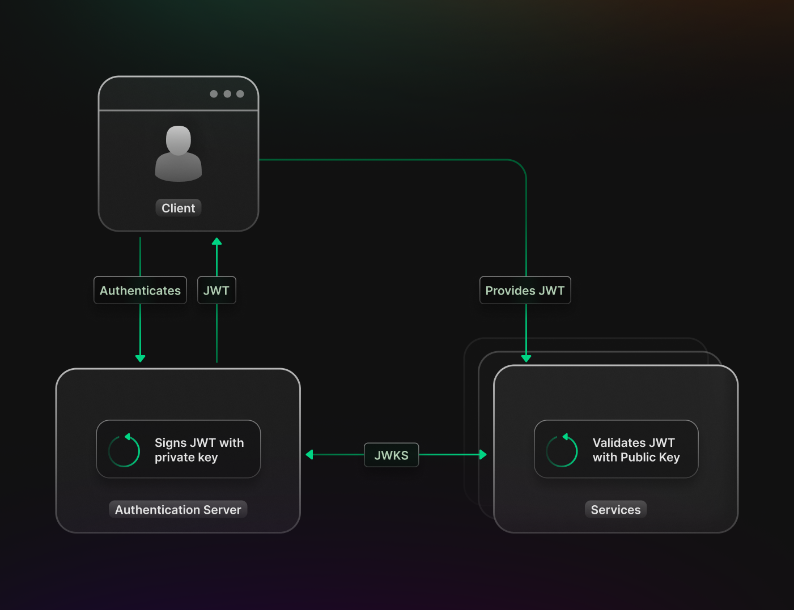
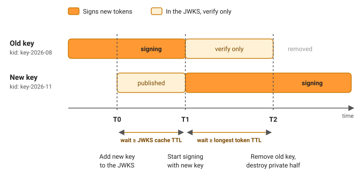

**A JWKS (JSON Web Key Set) is a JSON document with a `keys` array, where each entry is a public key in JSON Web Key (JWK) format. An auth server publishes its JWKS at a URL, usually advertised as `jwks_uri` in its discovery metadata, so any API can fetch the public keys and verify the signatures on the JWTs it issues.** The `kid` (key ID) in a token's header says which key in the set signed it, and that is what lets the issuer rotate keys without breaking the services that verify its tokens.

*Last updated 2 November 2026. Field definitions checked against [RFC 7517](https://www.rfc-editor.org/rfc/rfc7517.html) (JWK), [RFC 7518](https://www.rfc-editor.org/rfc/rfc7518.html) (JWA) and [RFC 8725](https://www.rfc-editor.org/rfc/rfc8725.html) (JWT best practices). Code tested with `jose` 6.2.15 on Node.js 20 and PyJWT 2.15.1 on Python 3.9.*

## Table of contents

- [JWK vs JWKS, and where the JWKS lives](#jwk-vs-jwks-and-where-the-jwks-lives)
- [A sample JWKS, field by field](#a-sample-jwks-field-by-field)
- [How a JWT is verified with a JWKS](#how-a-jwt-is-verified-with-a-jwks)
- [Verification code: Node.js and Python](#verification-code-nodejs-and-python)
- [Caching a JWKS without breaking rotation](#caching-a-jwks-without-breaking-rotation)
- [Key rotation, step by step](#key-rotation-step-by-step)
- [Common JWKS mistakes](#common-jwks-mistakes)
- [JWKS in SuperTokens](#jwks-in-supertokens)
- [Frequently Asked Questions](#frequently-asked-questions)

## JWK vs JWKS, and where the JWKS lives

A **JWK** is one key written as a JSON object ([RFC 7517, Section 4](https://www.rfc-editor.org/rfc/rfc7517.html#section-4)). A **JWKS** is a JSON object whose required `keys` member is an array of JWKs ([Section 5](https://www.rfc-editor.org/rfc/rfc7517.html#section-5)). Its registered media type is `application/jwk-set+json`.

A published JWKS holds **public keys only**. OpenID Connect Discovery says it "MUST NOT contain private or symmetric key values", which is also why a JWKS can't help with HS256 tokens: an HMAC secret can't be published (see [RS256 vs HS256](https://supertokens.com/blog/rs256-vs-hs256)).

Issuers advertise the JWKS URL in a metadata document:

| Where to look | Field | Defined in |
|---|---|---|
| `https://<issuer>/.well-known/openid-configuration` | `jwks_uri` (required, must be `https`) | [OpenID Connect Discovery 1.0](https://openid.net/specs/openid-connect-discovery-1_0.html), Sections 3 and 4 |
| `https://<issuer>/.well-known/oauth-authorization-server` | `jwks_uri` (optional) | [RFC 8414](https://www.rfc-editor.org/rfc/rfc8414.html), Sections 2 and 3 |

The JWKS path itself is up to the issuer. `/.well-known/jwks.json` is a common convention, not a standard, so read `jwks_uri` rather than guessing. SuperTokens, for example, serves the set at `<YOUR_API_DOMAIN>/auth/jwt/jwks.json` with the default API base path.

## A sample JWKS, field by field

Here's a realistic JWKS with two signing keys, one RSA (RS256) and one elliptic-curve (ES256). These are throwaway demo keys generated for this article; their private halves were deleted, so nothing can be signed with them.

```json
{
  "keys": [
    {
      "kty": "RSA",
      "kid": "demo-rsa-2026-11",
      "use": "sig",
      "alg": "RS256",
      "n": "ve4vw3OJ9U_Toxg4Z0GjjlQLxX4zVCZ-iJstPJQjNzq2Sa_YEc3vfe9XHL1D65FL4Eei5eSWRH_heitFJ7JkEsWqCB-E6T8JJTRmfS-WaDpUqF4vASPhmPCghM09dVkjdsynZEG2kg98Sn0XbBkIPMW0gFxmjGPA0LUtEJqAFFaspFrmyxfonR4m_Gc1Qa9WTbybQF_EbS-Utqq6V9pROPQXUfLknc-MRSr1jc4awbcdrTwgeeF3wXg4ux-KY-zHPN6X4tPrKi3P_UK3nIQm5ZcdcWlSMDQBqhsEIWvxlfxuTutISXS6uPA2uhelHfOx1zCpCkG8Wmh4hMKzg1wA2Q",
      "e": "AQAB"
    },
    {
      "kty": "EC",
      "kid": "demo-ec-2026-11",
      "use": "sig",
      "alg": "ES256",
      "crv": "P-256",
      "x": "uTfLgqKosipZjOILyVLsf-SOKU8cQ9RZvkz1t4qeBkg",
      "y": "Hvxrll8gLRkU8Sln5xlN5gtN2bA0z-AbXi_U0VYMzcg"
    }
  ]
}
```

| Field | Meaning | Required? | Spec |
|---|---|---|---|
| `kty` | Key type: the algorithm family, such as `RSA`, `EC` or `OKP` | Yes, in every JWK | RFC 7517 §4.1 |
| `kid` | Key ID. Matched against the `kid` in a JWT header to pick the key. Keys in one set SHOULD have distinct `kid` values | Optional in the spec, needed in practice once a set has more than one key | RFC 7517 §4.5 |
| `use` | Intended use: `sig` (signatures) or `enc` (encryption) | Optional, but OpenID Connect requires it on every key when a set has both kinds | RFC 7517 §4.2 |
| `alg` | The one algorithm this key is meant for, such as `RS256` or `ES256` | Optional | RFC 7517 §4.4 |
| `key_ops` | Finer-grained alternative to `use`, such as `["verify"]`. Should not be combined with `use` | Optional | RFC 7517 §4.3 |
| `n`, `e` | RSA modulus and public exponent, base64url-encoded. `AQAB` is 65537 | Required for RSA | RFC 7518 §6.3.1 |
| `crv`, `x`, `y` | Curve name (`P-256`, `P-384`, `P-521`) and the public point's coordinates | Required for EC | RFC 7518 §6.2.1 |
| `x5c` | X.509 certificate chain for the key, standard base64 (not base64url) | Optional | RFC 7517 §4.7 |
| `x5t#S256` | SHA-256 thumbprint of the key's X.509 certificate | Optional | RFC 7517 §4.9 |

Verifiers SHOULD ignore keys with a `kty` they don't understand ([§5](https://www.rfc-editor.org/rfc/rfc7517.html#section-5)), so adding a new key type doesn't break old clients. If a published JWK contains `d`, `p`, `q` or `k`, you're leaking private or symmetric key material.

For `kid` values, [RFC 7638](https://www.rfc-editor.org/rfc/rfc7638.html) offers the JWK thumbprint: a base64url SHA-256 hash of the key's required members, which gives every key a stable, unique ID.

## How a JWT is verified with a JWKS

A [JWT](https://supertokens.com/blog/what-is-jwt) has three parts: header, payload and signature. The header of a token signed with the RSA key above looks like this:

```json
{ "alg": "RS256", "kid": "demo-rsa-2026-11", "typ": "JWT" }
```

Verification goes like this:

1. **Read `kid` and `alg` from the header**, trusting neither yet.
2. **Check `alg` against your allowlist.** Reject `none` and anything you didn't configure.
3. **Find the key by `kid` in your cached JWKS.** Its `kty` and `alg` must fit the token's `alg`.
4. **If the `kid` isn't cached, refetch the JWKS once**, rate-limited. The issuer may have just published a new key.
5. **Verify the signature** with that public key.
6. **Validate the claims:** `exp` and `nbf` with a little clock-skew leeway, `iss` equal to the expected issuer, and `aud` containing your API's identifier ([RFC 8725, §3.9](https://www.rfc-editor.org/rfc/rfc8725.html#section-3.9)).
7. **Then authorize** using scopes, roles or other claims.



If you want to look at a real token's header and claims while you follow along, paste it into the [SuperTokens JWT encoder/decoder](https://supertokens.com/jwt-encoder-decoder).

## Verification code: Node.js and Python

You shouldn't write the cache or signature code yourself. Both libraries below implement the steps above. What you have to get right is the configuration.

### Node.js with `jose`

`createRemoteJWKSet` fetches the set, caches it, selects the key by `kid` and `alg`, and refetches on an unknown `kid`. The timing values shown are the library's defaults, written out so you can see and tune them.

```js
import * as jose from "jose";

const ISSUER = "https://auth.example.com";
const AUDIENCE = "https://api.example.com";

// Create this once per process and reuse it: the cache lives inside it.
const JWKS = jose.createRemoteJWKSet(new URL(`${ISSUER}/.well-known/jwks.json`), {
  cacheMaxAge: 10 * 60 * 1000, // refetch the set after 10 minutes
  cooldownDuration: 30 * 1000, // refetch on an unknown kid at most once every 30 seconds
  timeoutDuration: 5 * 1000, // give up on a slow JWKS endpoint after 5 seconds
});

export async function verifyAccessToken(token) {
  const { payload } = await jose.jwtVerify(token, JWKS, {
    issuer: ISSUER,
    audience: AUDIENCE,
    algorithms: ["RS256", "ES256"], // an allowlist, never the token's own say-so
  });
  return payload;
}

// Express middleware: a token that fails verification is a 401, not a 403.
export async function requireAuth(req, res, next) {
  const [scheme, token] = (req.headers.authorization ?? "").split(" ");
  if (scheme !== "Bearer" || !token) {
    return res.set("WWW-Authenticate", 'Bearer realm="api"').sendStatus(401);
  }
  try {
    req.auth = await verifyAccessToken(token);
    next();
  } catch {
    res.set("WWW-Authenticate", 'Bearer realm="api", error="invalid_token"').sendStatus(401);
  }
}
```

A failed signature or claim check is an authentication failure, so it returns 401 with a `WWW-Authenticate` header. Save 403 for valid tokens that lack permission. [401 vs 403](https://supertokens.com/blog/http-error-codes-401-vs-403) covers the difference.

### Python with PyJWT

`PyJWKClient` caches the whole set for `lifespan` seconds and, from PyJWT 2.14, rate-limits refetches with `cooldown_duration`. Here `cooldown_duration` is the default, `lifespan` is raised from 300 seconds and `timeout` is lowered from 30 seconds.

```python
import jwt
from jwt import PyJWKClient

ISSUER = "https://auth.example.com"
AUDIENCE = "https://api.example.com"

# Create this once per process and reuse it: the cache lives inside it.
jwks_client = PyJWKClient(
    f"{ISSUER}/.well-known/jwks.json",
    lifespan=600,          # refetch the set after 10 minutes
    cooldown_duration=30,  # refetch on an unknown kid at most once every 30 seconds
    timeout=5,
)


def verify_access_token(token: str) -> dict:
    # Reads kid from the header, looks it up in the cached set and
    # refetches the set once if the kid isn't there.
    signing_key = jwks_client.get_signing_key_from_jwt(token)
    return jwt.decode(
        token,
        signing_key,  # a PyJWK, so the key's own alg is enforced too
        algorithms=["RS256", "ES256"],
        audience=AUDIENCE,
        issuer=ISSUER,
        options={"require": ["exp", "iss", "aud"]},
    )
```

Passing the `PyJWK` object rather than `signing_key.key` lets PyJWT check that the token's `alg` matches the key's `alg`. In our tests, a token whose header claimed `ES256` but pointed at the RSA key's `kid` was rejected with "Token algorithm 'ES256' does not match the key's algorithm 'RS256'".

Against a local JWKS server, both snippets accepted valid RS256 and ES256 tokens and rejected tokens with the wrong audience, `alg: none`, an HS256 token "signed" with the RSA public key, and an unknown `kid`.

## Caching a JWKS without breaking rotation

There are two ways to get JWKS caching wrong. **No caching** adds a network round trip to every API call and makes the issuer a single point of failure for every service. **Caching forever** works until the issuer rotates, and then every token signed with the new key fails until each service restarts.

The working pattern has four parts:

- **A TTL on the whole set**, from minutes to hours (`cacheMaxAge` in `jose`, `lifespan` in PyJWT). Neither library reads the JWKS response's `Cache-Control` header, so if your issuer sends one, set your TTL to match.
- **Refetch on an unknown `kid`.** OpenID Connect Core, Section 10.1.1 describes this: a verifier that sees an unfamiliar `kid` fetches `jwks_uri` again.
- **A cooldown on those refetches.** Anyone can send a token with a random `kid`. Without a limit, each one triggers a fetch, and your API ends up hammering your identity provider. Both libraries allow one forced refetch per 30 seconds by default. In our tests, a bogus `kid` sent within the cooldown caused no extra fetch.
- **A fetch timeout**, so a hung JWKS endpoint can't tie up request threads.

The cooldown matters for rotation. When we published a new key and used it straight away, a verifier that had refetched in the previous 30 seconds rejected the token with "no matching key" until the cooldown ran out. Issuers have to plan around verifier caches.

## Key rotation, step by step

Rotation replaces a signing key without causing a wave of failed verifications. The rule: **a public key must be in every verifier's cache before any token signed with it arrives, and must stay there until every token it signed has expired.**



1. **Generate the new key pair** in your KMS or HSM, with a new `kid`.
2. **Publish the new public key (T0).** Add it to the JWKS next to the current key. Keep signing with the old key.
3. **Wait at least one verifier cache TTL.** If verifiers cache the set for 10 minutes, wait more than 10 minutes, plus margin for CDN caching in front of the JWKS URL. Every verifier now has both keys.
4. **Start signing with the new key (T1).** New tokens carry the new `kid`. The old key becomes verify-only.
5. **Wait at least the longest token lifetime.** Tokens signed with the old key just before T1 are valid until they expire. With 1-hour access tokens, wait more than an hour. If the old key also signed longer-lived JWTs, such as ID tokens or signed links, the longest of those sets the wait.
6. **Remove the old key from the JWKS (T2)** and destroy its private half.

### What goes wrong when you skip the overlap

- **Signing with a key before publishing it:** verifiers with a warm cache don't know the `kid`. Those within their refetch cooldown reject the token outright, and those outside it all refetch at once. Users see 401s until caches catch up.
- **Removing the old key the moment you switch:** every token signed in the last hour fails as soon as a verifier refreshes its cache. For session tokens, that looks like a mass logout.
- **Reusing a `kid` for a different key:** verifiers that cached the old key under that `kid` fail signature checks with no reason to refetch. Never reuse a `kid`.

Real systems follow this pattern. Amazon EKS rotates the private key for its service account token issuer every 7 days and keeps the public keys in the JWKS until they expire. SuperTokens rotates its access token signing key every 168 hours (7 days) by default, and existing sessions stay logged in across the change.

**How often should you rotate?** None of the RFCs cited here sets a period. Automate rotation so it's routine, pick an interval that suits your risk model (weekly to yearly is common), and practice emergency rotation. If a private key leaks, remove its public key immediately and accept the 401s: tokens signed with a leaked key can't be trusted, whoever signed them.

## Common JWKS mistakes

- **Accepting `alg: none`.** An unsigned token has no signature to check. RFC 8725 §3.1 requires libraries to let you specify allowed algorithms; always pass the allowlist.
- **Algorithm confusion.** If the token picks its own algorithm, an attacker can switch `RS256` to `HS256` and "sign" with your RSA public key as the HMAC secret, which some libraries then accept ([RFC 8725, §2.1](https://www.rfc-editor.org/rfc/rfc8725.html#section-2.1)). The fix is an allowlist plus "each key MUST be used with exactly one algorithm" (§3.1).
- **Trusting `jku`, `x5u` or an embedded `jwk` header.** These let the token say where its key lives, so an attacker can point to their own. RFC 8725 §3.10 adds that fetching such URLs enables SSRF, and OpenID Connect Core says ID tokens SHOULD NOT use them. Use only the JWKS URL you configured.
- **Treating `kid` as safe input.** It's attacker-controlled until the signature verifies, and RFC 8725 §3.10 warns of SQL and LDAP injection through `kid` lookups. Match it against your in-memory set only.
- **Skipping `iss` and `aud`.** A signature only proves who signed. If one issuer serves several APIs, a token for one verifies at all of them unless you check `aud`.
- **No caching, or caching forever**, both covered above.

A valid signature also doesn't mean the token hasn't been revoked. A JWT keeps verifying until it expires, so if you need to cut off access sooner, see [7 ways to revoke JWTs](https://supertokens.com/blog/revoking-access-with-a-jwt-blacklist).

## JWKS in SuperTokens

SuperTokens signs session access tokens with RS256 and publishes the verification keys at `<YOUR_API_DOMAIN>/auth/jwt/jwks.json` (with the default `/auth` API base path). The backend SDKs verify sessions for you. If a service has no SDK, you can verify tokens with any JWKS-aware library, as shown in the docs on [manual JWT verification](https://supertokens.com/docs/additional-verification/session-verification/protect-api-routes#manual-jwt-verification): select the key by `kid` and restrict verification to `RS256`.

Signing keys are dynamic by default and rotate every 168 hours. You can change the interval with `access_token_dynamic_signing_key_update_interval`, or switch to a static key, as described in [access token signing key rotation](https://supertokens.com/docs/post-authentication/session-management/security#access-token-signing-key-rotation). The same JWKS is how services verify M2M tokens from SuperTokens' OAuth2 provider; see [machine-to-machine authentication](https://supertokens.com/blog/machine-to-machine-authentication) for that flow.

## Frequently Asked Questions

### What is a JWKS endpoint?

A JWKS endpoint is an HTTPS URL where an auth server publishes its current public signing keys as a JSON Web Key Set. APIs fetch it to verify the signatures on JWTs from that server. The endpoint is public, needs no authentication and contains no secrets.

### Where is the JWKS endpoint located?

Read the `jwks_uri` field from the issuer's discovery document, at `/.well-known/openid-configuration` (OpenID Connect) or `/.well-known/oauth-authorization-server` (RFC 8414). Many providers serve the set at `/.well-known/jwks.json`, but that path is a convention, not a standard. SuperTokens uses `<YOUR_API_DOMAIN>/auth/jwt/jwks.json`.

### What is the kid in a JWT?

The `kid` (key ID) header names the key that signed the token. Verifiers look up the matching `kid` in the JWKS to choose the right public key, which is what allows several keys to be published at once during rotation. RFC 7517 says keys in a set should have distinct `kid` values, and a `kid` should never be reused for a different key.

### How often should JWKS signing keys be rotated?

No RFC sets a required interval. Automate rotation and choose a period that fits your risk model; weekly to yearly is common. Amazon EKS and SuperTokens both rotate every 7 days by default. Whatever the interval, publish the new key before signing with it and keep the old key until the longest-lived token it signed has expired.

### How should I cache a JWKS?

Cache the whole set in memory with a TTL of a few minutes to hours, refetch once when a token arrives with an unknown `kid`, rate-limit those refetches (for example, one per 30 seconds), and set a fetch timeout. Don't fetch on every request, and don't cache forever. `jose`'s `createRemoteJWKSet` and PyJWT's `PyJWKClient` implement this pattern.

### What's the difference between a JWKS and a PEM public key?

Both can hold the same public key. A PEM file is one key in a base64-encoded binary format with no metadata. A JWKS is JSON, can hold several keys at once, and labels each with a `kid`, `alg` and `use`. That makes rotation possible without redeploying every verifier, which is why OAuth and OpenID Connect providers publish a JWKS.

## Related reading

- [What Is a JWT? Understanding JSON Web Tokens](https://supertokens.com/blog/what-is-jwt)
- [RS256 vs HS256: Understanding the Difference in JWT Signing](https://supertokens.com/blog/rs256-vs-hs256)
- [OAuth vs JWT: An In-Depth Comparison](https://supertokens.com/blog/oauth-vs-jwt)
- [Machine-to-Machine (M2M) Authentication: Methods and AI Agents](https://supertokens.com/blog/machine-to-machine-authentication)
- [OpenID Connect vs OAuth2](https://supertokens.com/blog/openid-connect-vs-oauth2)
